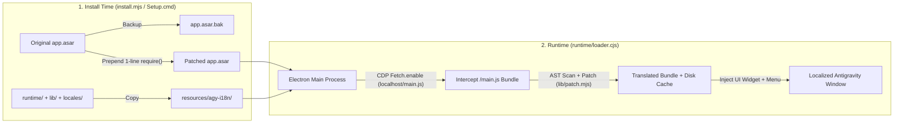

<div align="center">

# 🌐 Antigravity-i18n (`agy-i18n`)

**Multilingual UI Localization & Live Language Switcher for the Google Antigravity Desktop Client**  
*Google Antigravity 桌面客户端多语言汉化补丁与实时语言切换工具*

[](https://github.com/Violiate/Antigravity-i18n/actions/workflows/ci-release.yml)
[](https://github.com/Violiate/Antigravity-i18n/releases)
[](#supported-languages)
[](#supported-languages)
[](#quick-start-tutorial)
[](./LICENSE)

<p align="center">
  <b>🌍 Read this documentation in your language:</b><br>
  <strong>English</strong> ·
  <a href="./docs/README.zh-CN.md">简体中文</a> ·
  <a href="./docs/README.zh-TW.md">繁體中文</a> ·
  <a href="./docs/README.ja.md">日本語</a> ·
  <a href="./docs/README.ko.md">한국어</a> ·
  <a href="./docs/README.es.md">Español</a> ·
  <a href="./docs/README.fr.md">Français</a> ·
  <a href="./docs/README.de.md">Deutsch</a> ·
  <a href="./docs/README.pt-BR.md">Português (Brasil)</a> ·
  <a href="./docs/README.ru.md">Русский</a>
</p>

</div>

---

## ✨ Overview

**Antigravity-i18n** brings full multilingual localization and live in-app language switching to the **Google Antigravity Desktop Client**. Powered by an Acorn AST string scanner/patcher and a lightweight Electron runtime loader, it translates **2,175 UI strings** across **14 mainstream world languages** without breaking JavaScript syntax or modifying your user data.

- 🌍 **14 Mainstream Languages**: Complete 2,175-entry dictionaries for Simplified Chinese (`zh-CN`), Traditional Chinese (`zh-TW`), Japanese (`ja`), Korean (`ko`), Spanish (`es`), French (`fr`), German (`de`), Brazilian Portuguese (`pt-BR`), Russian (`ru`), Italian (`it`), Vietnamese (`vi`), Turkish (`tr`), and Arabic (`ar`), plus instant pass-through to original English (`en`).
- ⚡ **Live Language Switching**: Switch languages at any time from the **bottom-right floating selector**, the **top window menu (`Language / 语言`)**, or the **CLI** — refreshes the UI in place without reinstalling.
- 🪄 **Zero-Dependency Windows GUI Installer (`Setup.cmd`)**: The standalone Windows release ZIP bundles a pinned, SHA-256 verified official Node.js runtime and all dependencies. **No Node.js, npm, or internet connection is required.**
- 🛡️ **Safe & 1-Click Reversible**: Automatically backs up your original `app.asar` to `app.asar.bak` before installing. Restore the untouched original client at any time with a single click.
- 🌐 **Localhost-Safe Proxy Configuration**: Optional HTTP/HTTPS proxy setting that automatically bypasses `localhost`, `127.0.0.1`, and `[::1]` so local language servers always connect directly.

---

<a id="quick-start-tutorial"></a>

## 🚀 Quick Start Tutorial

### Option A: Windows 1-Click GUI Installer (Recommended — No Node.js Required)

> **中文速览**：下载 Release 中的 `agy-i18n-1.1.0-windows-x64.zip` -> **完整解压整个文件夹** -> 完全退出 Antigravity（含托盘图标） -> 双击 **`Setup.cmd`** -> 选择语言并点击 **“安装 / 更新”** 即可！（完整中文教程请见 [简体中文文档](./docs/README.zh-CN.md)）

1. **Download the Release Package**  
   Go to the [**Releases**](https://github.com/Violiate/Antigravity-i18n/releases) page and download `agy-i18n-1.1.0-windows-x64.zip` (along with its `.sha256` checksum if you wish to verify integrity).
2. **Extract the Archive**  
   **Extract the entire ZIP folder** to any location on your computer. *(Do not double-click `Setup.cmd` directly from inside a unextracted ZIP preview window.)*
3. **Close Antigravity Completely**  
   Save your work and quit the Antigravity desktop client completely (including the system tray icon). The installer checks for running processes and will never forcibly terminate your active session.
4. **Run `Setup.cmd`**  
   Double-click **`Setup.cmd`** to launch the graphical installer:
   - **Installation Directory (`Antigravity 目录`)**: Automatically detected. If your client is installed in a custom location, click **浏览... (Browse)** to select the Antigravity folder or its `resources` subdirectory.
   - **Initial Language (`初始界面语言`)**: Pick your preferred display language from the 14 supported locales.
   - **Optional Proxy (`可选代理`)**: Leave blank if not needed, or enter an `http://` / `https://` proxy (e.g. `http://127.0.0.1:7890`). Existing proxy settings are preserved automatically.
   - Click **安装 / 更新 (Install / Update)**.
5. **Launch & Enjoy!**  
   Start Antigravity normally from your usual shortcut.

---

### Option B: Install from Source via CLI (For Developers)

#### 1. Prerequisites
- **Node.js**: `>= 22.12.0`
- **Google Antigravity Desktop Client** (verified on Windows client `2.29.0`)

#### 2. Clone & Install Dependencies
```bash
git clone https://github.com/Violiate/Antigravity-i18n.git
cd Antigravity-i18n
npm install
```

#### 3. Apply the Localization Patch
> [!IMPORTANT]
> Make sure the Antigravity desktop client is **completely closed** before running `install` or `restore`.

```bash
# Install with default language (zh-CN)
npm run setup
# Equivalent to: node install.mjs install

# Or install with a specific initial language (e.g., Japanese, Traditional Chinese, Korean, French)
node install.mjs install ja
node install.mjs install zh-TW
node install.mjs install ko
```

If Antigravity is installed in a non-default path (for example `D:\Program Files\Antigravity`), pass `--dir` or set the `AGY_PATH` environment variable:

```bash
node install.mjs install --dir "D:\Program Files\Antigravity"
```

---

## 🔄 Switching Languages Live (3 Ways)

Once installed, you can switch the display language at any time without re-running the installer:

1. **Bottom-Right Floating Language Selector**  
   Click the language selector pill in the **bottom-right corner** of the Antigravity window and choose any of the 14 languages.
2. **Top Window Menu Bar**  
   Click **`Language / 语言`** in the top application menu bar and select your target language.
3. **Command Line (`language.mjs`)**  
   ```bash
   # List all supported language codes
   node language.mjs list

   # Switch to any supported language code
   node language.mjs zh-CN
   node language.mjs zh-TW
   node language.mjs ja
   node language.mjs ko
   node language.mjs es
   node language.mjs fr
   node language.mjs de
   node language.mjs pt-BR
   node language.mjs ru
   node language.mjs it
   node language.mjs vi
   node language.mjs tr
   node language.mjs ar
   node language.mjs en
   ```

> [!NOTE]
> Switching languages triggers a renderer reload (`reloadIgnoringCache`) so the newly translated script bundle takes effect immediately. Please save or submit any draft input before switching.

---

<a id="supported-languages"></a>

## 🌍 Supported Languages

All 13 translation dictionaries live in [`locales/`](./locales) and are validated against the Acorn AST patcher in CI:

| Code (`locale`) | Native Name | English Name | Translated Keys | Mode |
| :--- | :--- | :--- | :--- | :--- |
| `en` | English | English (Original) | Pass-through | Unmodified original UI |
| `zh-CN` | 简体中文 | Simplified Chinese | 2,175 | AST Patched |
| `zh-TW` | 繁體中文 | Traditional Chinese | 2,175 | AST Patched |
| `ja` | 日本語 | Japanese | 2,175 | AST Patched |
| `ko` | 한국어 | Korean | 2,175 | AST Patched |
| `es` | Español | Spanish | 2,175 | AST Patched |
| `fr` | Français | French | 2,175 | AST Patched |
| `de` | Deutsch | German | 2,175 | AST Patched |
| `pt-BR` | Português (Brasil) | Brazilian Portuguese | 2,175 | AST Patched |
| `ru` | Русский | Russian | 2,175 | AST Patched |
| `it` | Italiano | Italian | 2,175 | AST Patched |
| `vi` | Tiếng Việt | Vietnamese | 2,175 | AST Patched |
| `tr` | Türkçe | Turkish | 2,175 | AST Patched |
| `ar` | العربية | Arabic | 2,175 | AST Patched *(LTR layout)* |

---

## 🧠 How It Works



1. **Minimal ASAR Entry Hook**: During installation, `install.mjs` creates a byte-exact backup (`app.asar.bak`), unpacks `app.asar`, prepends a single `require('../agy-i18n/runtime/loader.cjs')` line to `dist/main.js`, and repacks `app.asar`.
2. **CDP Fetch Interception**: At runtime, `runtime/loader.cjs` attaches to each window's `webContents.debugger` via the Chrome DevTools Protocol (`Fetch.enable`) and intercepts only the local renderer script (`http://localhost:*/main.js`).
3. **AST-Safe String Replacement & Caching**: `lib/scan.mjs` and `lib/patch.mjs` parse the JavaScript bundle with `acorn`, locate eligible UI display literals while skipping code identifiers/internal tokens, replace matching strings from `locales/<locale>.json`, verify the resulting AST parses cleanly, and cache the patched bundle on disk keyed by `(sha256, locale)`.

---

## ⚙️ Status, Restore & Advanced Configuration

### Check Status or Restore Original Client
- **Via Windows GUI (`Setup.cmd`)**: Open `Setup.cmd` and click **检查状态 (Check Status)** or **还原原版 (Restore Original)**.
- **Via CLI**:
  ```bash
  # Check installation status, detected path, and active locale
  npm run status

  # Restore the original untouched app.asar (close Antigravity first)
  npm run restore
  ```

### Runtime Configuration (`config.json`)
After installation, runtime settings are stored in `<Antigravity>/resources/agy-i18n/config.json`:

```json
{
  "locale": "zh-CN",
  "proxy": "http://127.0.0.1:7890"
}
```

- `locale`: Active UI language code (`en`, `zh-CN`, `zh-TW`, `ja`, `ko`, `es`, `fr`, `de`, `pt-BR`, `ru`, `it`, `vi`, `tr`, `ar`).
- `proxy` *(optional)*: Accepts `http://` or `https://` proxy URLs. Automatically configures Electron's session/global proxy while enforcing `<local>;localhost;127.0.0.1;[::1]` bypass rules.

---

## 📌 Scope, Limitations & FAQ

- **What if Antigravity updates and my translation disappears?**  
  Client updates overwrite `app.asar`. Simply quit Antigravity, run `Setup.cmd` (or `npm run setup`), and click **Install / Update** again. There is no background daemon running when Antigravity is closed.
- **Why are some dynamic sentences still in English?**  
  Only static UI strings inside the local `/main.js` bundle (2,175 keys) are patched. Server-generated responses, dynamic templates, or lazy-loaded chunks outside `/main.js` remain in English.
- **Does Arabic (`ar`) include RTL layout mirroring?**  
  The Arabic dictionary includes all 2,175 translated strings, but full Right-to-Left (RTL) CSS layout adaptation is not currently applied.
- **Windows SmartScreen says "Windows protected your PC / Unknown Publisher"?**  
  The standalone offline package is not signed with a commercial code-signing certificate. Click **More info** -> **Run anyway**.
- **Is macOS or Linux supported?**  
  The prebuilt offline GUI package (`Setup.cmd`) targets **Windows x64**. `lib/env.mjs` includes path discovery helpers for macOS and Linux for CLI experimentation, but only Windows x64 has been end-to-end verified. See [TESTING.md](./TESTING.md) for details.

---

## 🧪 Testing, Packaging & CI/CD Pipeline

This repository includes an automated GitHub Actions workflow ([`.github/workflows/ci-release.yml`](./.github/workflows/ci-release.yml)) that runs on every push, pull request, and `v*` version tag:

1. **Unit & AST Integrity Tests (`npm test`)**: Validates all 13 locale JSON files (2,175 keys each) and runs Acorn AST scan/patch syntax verification across every language.
2. **Deterministic Windows Offline Packaging (`npm run build:windows`)**: Downloads the official Node.js `v22.23.4` Windows x64 archive, verifies its pinned SHA-256 (`cbc74b5e...`), stages an explicit allowlist of runtime files, generates `MANIFEST.json`, and outputs `dist/agy-i18n-<version>-windows-x64.zip` + `.sha256`.
3. **Offline Package & GUI Smoke Test (`npm run test:package`)**: Strips developer Node/npm from `PATH`, extracts the built ZIP into a path containing spaces and Unicode characters, verifies every file hash against `MANIFEST.json`, runs `discover -> install -> status -> repeat install -> restore` against a fixture `app.asar`, and executes `Setup.ps1 -SmokeTest`.
4. **Automated GitHub Releases**: Pushing a tag matching `v*` (e.g. `git tag v1.1.0 && git push origin v1.1.0`) automatically publishes the verified `.zip` and `.sha256` to GitHub Releases.

```bash
# Run unit & multilingual AST tests
npm test

# Preview offline AST patching on captured main.js (if present)
npm run preview:all

# Build the standalone Windows x64 ZIP package locally
npm run build:windows

# Run the full offline package & GUI regression suite
npm run test:package
```

---

## 🤝 Contributing Translations

1. Locale dictionaries are stored in [`locales/`](./locales) as `{ "Original English String": "Translated String" }`.
2. Language metadata is registered in [`locales/languages.json`](./locales/languages.json).
3. After editing or adding translations, run `npm test` to verify JSON formatting, non-empty values, and AST syntax safety before opening a Pull Request.

---

## 📄 License

Released under the [MIT License](./LICENSE).
