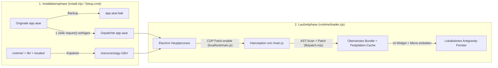

<div align="center">

# 🌐 Antigravity-i18n (`agy-i18n`)

**Mehrsprachige UI-Lokalisierung & Live-Sprachwechsler für den Google Antigravity Desktop-Client**  
*Multilingual UI Localization & Live Language Switcher for the Google Antigravity Desktop Client*

[](https://github.com/Violiate/Antigravity-i18n/actions/workflows/ci-release.yml)
[](https://github.com/Violiate/Antigravity-i18n/releases)
[](#supported-languages)
[](#supported-languages)
[](#quick-start-tutorial)
[](../LICENSE)

<p align="center">
  <b>🌍 Lesen Sie diese Dokumentation in Ihrer Sprache:</b><br>
  <a href="../README.md">English</a> ·
  <a href="./README.zh-CN.md">简体中文</a> ·
  <a href="./README.zh-TW.md">繁體中文</a> ·
  <a href="./README.ja.md">日本語</a> ·
  <a href="./README.ko.md">한국어</a> ·
  <a href="./README.es.md">Español</a> ·
  <a href="./README.fr.md">Français</a> ·
  <strong>Deutsch</strong> ·
  <a href="./README.pt-BR.md">Português (Brasil)</a> ·
  <a href="./README.ru.md">Русский</a>
</p>

</div>

---

## ✨ Übersicht

**Antigravity-i18n** bietet eine vollständige mehrsprachige Lokalisierung und einen Live-Sprachwechsel direkt im **Google Antigravity Desktop-Client**. Ausgestattet mit einem auf dem Acorn AST (abstrakter Syntaxbaum) basierenden String-Scanner/Patcher und einem leichtgewichtigen Electron-Runtime-Loader übersetzt das Tool **2.175 UI-Texte** in **14 weltweite Hauptsprachen**, ohne die JavaScript-Syntax zu beschädigen oder Ihre Benutzerdaten zu verändern.

- 🌍 **14 Hauptsprachen**: Vollständige Wörterbücher mit jeweils 2.175 Einträgen für vereinfachtes Chinesisch (`zh-CN`), traditionelles Chinesisch (`zh-TW`), Japanisch (`ja`), Koreanisch (`ko`), Spanisch (`es`), Französisch (`fr`), Deutsch (`de`), brasilianisches Portugiesisch (`pt-BR`), Russisch (`ru`), Italienisch (`it`), Vietnamesisch (`vi`), Türkisch (`tr`) und Arabisch (`ar`), ergänzt durch eine direkte Rückkehr zum englischen Original (`en`).
- ⚡ **Live-Sprachwechsel im laufenden Betrieb**: Wechseln Sie die Sprache jederzeit über die **schwebende Sprachauswahl unten rechts**, das **obere Fenstermenü (`Language / 语言`)** oder die **Kommandozeile (CLI)** — die Benutzeroberfläche wird sofort im laufenden Betrieb aktualisiert, ohne dass eine Neuinstallation erforderlich ist.
- 🪄 **Windows-Grafikinstaller ohne externe Abhängigkeiten (`Setup.cmd`)**: Das eigenständige Windows-Release-ZIP enthält eine fest vorgegebene, per SHA-256 verifizierte offizielle Node.js-Laufzeitumgebung und alle erforderlichen Bibliotheken. **Es ist weder eine Node.js-/npm-Installation noch eine Internetverbindung erforderlich.**
- 🛡️ **Sicher & mit 1 Klick wiederherstellbar**: Sichert vor der Installation automatisch Ihre originale `app.asar` als `app.asar.bak`. Stellen Sie den unveränderten Originalzustand jederzeit mit einem einzigen Klick wieder her.
- 🌐 **Sichere Proxy-Konfiguration mit Localhost-Bypass**: Optionale HTTP/HTTPS-Proxy-Einstellung, die Verbindungen zu `localhost`, `127.0.0.1` und `[::1]` automatisch umgeht, sodass lokale Language Server stets direkt und störungsfrei kommunizieren.

---

<a id="quick-start-tutorial"></a>

## 🚀 Schnellanleitung

### Option A: Windows 1-Klick-Grafikinstaller (Empfohlen – kein Node.js erforderlich)

> **Kurzübersicht**: Laden Sie `agy-i18n-1.1.0-windows-x64.zip` von den Releases herunter -> **ZIP-Archiv vollständig in einen Ordner entpacken** -> Beenden Sie Antigravity vollständig (inklusive Taskleisten-Symbol) -> Doppelklick auf **`Setup.cmd`** -> Sprache auswählen und auf **„Installieren / Aktualisieren“** klicken!

1. **Release-Paket herunterladen**  
   Öffnen Sie die [**Releases**](https://github.com/Violiate/Antigravity-i18n/releases)-Seite und laden Sie `agy-i18n-1.1.0-windows-x64.zip` herunter (optional mit der Prüfsumme `.sha256` zur Integritätsprüfung).
2. **Archiv entpacken**  
   **Entpacken Sie den gesamten ZIP-Ordner** an einen beliebigen Ort auf Ihrem PC. *(Starten Sie `Setup.cmd` nicht direkt aus der Vorschau eines ungepackten ZIP-Archivs.)*
3. **Antigravity vollständig beenden**  
   Speichern Sie Ihre Arbeit und beenden Sie den Antigravity Desktop-Client vollständig (auch das Symbol im Infobereich/System-Tray der Taskleiste). Der Installer prüft laufende Prozesse und beendet niemals gewaltsam eine aktive Arbeitssitzung.
4. **`Setup.cmd` ausführen**  
   Doppelklicken Sie auf **`Setup.cmd`**, um den grafischen Installer zu starten:
   - **Antigravity-Verzeichnis (`Antigravity 目录`)**: Wird automatisch erkannt. Falls Sie den Client an einem benutzerdefinierten Speicherort installiert haben, klicken Sie auf **浏览... (Durchsuchen)**, um den Antigravity-Ordner oder dessen Unterverzeichnis `resources` auszuwählen.
   - **Ausgangssprache (`初始界面语言`)**: Wählen Sie Ihre bevorzugte Anzeigesprache aus den 14 unterstützten Sprachen aus.
   - **Optionaler Proxy (`可选代理`)**: Frei lassen, falls kein Proxy benötigt wird, oder eine `http://`- bzw. `https://`-Adresse eintragen (z. B. `http://127.0.0.1:7890`). Vorhandene Proxy-Einstellungen werden automatisch übernommen.
   - Klicken Sie auf **安装 / 更新 (Installieren / Aktualisieren)**.
5. **Starten & genießen!**  
   Starten Sie Antigravity wie gewohnt über Ihre reguläre Verknüpfung.

---

### Option B: Installation aus dem Quellcode via CLI (Für Entwickler)

#### 1. Voraussetzungen
- **Node.js**: `>= 22.12.0`
- **Google Antigravity Desktop-Client** (getestet unter Windows mit Client `2.29.0`)

#### 2. Klonen & Abhängigkeiten installieren
```bash
git clone https://github.com/Violiate/Antigravity-i18n.git
cd Antigravity-i18n
npm install
```

#### 3. Lokalisierungs-Patch anwenden
> [!IMPORTANT]
> Vergewissern Sie sich, dass der Antigravity Desktop-Client **vollständig beendet** ist, bevor Sie `install` oder `restore` ausführen.

```bash
# Standardinstallation (Standardsprache: zh-CN)
npm run setup
# Entspricht: node install.mjs install

# Oder Installation mit einer bestimmten Ausgangssprache (z. B. Deutsch, Japanisch, Spanisch)
node install.mjs install de
node install.mjs install ja
node install.mjs install es
```

Falls Antigravity in einem abweichenden Verzeichnis installiert ist (z. B. `D:\Program Files\Antigravity`), übergeben Sie den Parameter `--dir` oder setzen Sie die Umgebungsvariable `AGY_PATH`:

```bash
node install.mjs install --dir "D:\Program Files\Antigravity"
```

---

## 🔄 Live-Sprachwechsel (3 Wege)

Nach der Installation können Sie die Oberflächensprache jederzeit wechseln, ohne den Installer erneut ausführen zu müssen:

1. **Schwebender Sprachauswahl-Button unten rechts**  
   Klicken Sie auf den Sprachauswahl-Button in der **unteren rechten Ecke** des Antigravity-Fensters und wählen Sie eine der 14 Sprachen aus.
2. **Obere Fenstermenüleiste**  
   Klicken Sie in der oberen Menüleiste des Fensters auf **`Language / 语言`** und wählen Sie Ihre Zielsprache aus.
3. **Kommandozeile (`language.mjs`)**  
   ```bash
   # Alle unterstützten Sprachcodes auflisten
   node language.mjs list

   # Zu einem beliebigen unterstützten Sprachcode wechseln
   node language.mjs de
   node language.mjs en
   node language.mjs zh-CN
   node language.mjs zh-TW
   node language.mjs ja
   node language.mjs ko
   node language.mjs es
   node language.mjs fr
   node language.mjs pt-BR
   node language.mjs ru
   node language.mjs it
   node language.mjs vi
   node language.mjs tr
   node language.mjs ar
   ```

> [!NOTE]
> Der Sprachwechsel löst ein Neuladen des Renderers aus (`reloadIgnoringCache`), damit das neu übersetzte Skript-Bundle sofort aktiv wird. Bitte speichern oder übermitteln Sie offene Eingaben vor dem Umschalten.

---

<a id="supported-languages"></a>

## 🌍 Unterstützte Sprachen

Alle 13 Übersetzungswörterbücher befinden sich in [`locales/`](../locales) und werden in der CI über den Acorn-AST-Patcher validiert:

| Code (`locale`) | Einheimischer Name | Englischer Name | Übersetzte Texte | Modus |
| :--- | :--- | :--- | :--- | :--- |
| `en` | English | English (Original) | Direktes Pass-through | Unverändertes englisches Original |
| `zh-CN` | 简体中文 | Simplified Chinese | 2.175 | AST-dynamischer Patch |
| `zh-TW` | 繁體中文 | Traditional Chinese | 2.175 | AST-dynamischer Patch |
| `ja` | 日本語 | Japanese | 2.175 | AST-dynamischer Patch |
| `ko` | 한국어 | Korean | 2.175 | AST-dynamischer Patch |
| `es` | Español | Spanish | 2.175 | AST-dynamischer Patch |
| `fr` | Français | French | 2.175 | AST-dynamischer Patch |
| `de` | Deutsch | German | 2.175 | AST-dynamischer Patch |
| `pt-BR` | Português (Brasil) | Brazilian Portuguese | 2.175 | AST-dynamischer Patch |
| `ru` | Русский | Russian | 2.175 | AST-dynamischer Patch |
| `it` | Italiano | Italian | 2.175 | AST-dynamischer Patch |
| `vi` | Tiếng Việt | Vietnamese | 2.175 | AST-dynamischer Patch |
| `tr` | Türkçe | Turkish | 2.175 | AST-dynamischer Patch |
| `ar` | العربية | Arabic | 2.175 | AST-dynamischer Patch *(LTR-Layout)* |

---

## 🧠 Funktionsweise



1. **Minimaler ASAR-Einstiegshaken**: Bei der Installation erstellt `install.mjs` ein bytegenaues Backup (`app.asar.bak`), entpackt `app.asar`, stellt eine einzelne Codezeile `require('../agy-i18n/runtime/loader.cjs')` an den Anfang von `dist/main.js` und packt `app.asar` wieder zusammen.
2. **CDP Fetch-Interzeption**: Zur Laufzeit klinkt sich `runtime/loader.cjs` über das Chrome DevTools Protocol (`Fetch.enable`) in das `webContents.debugger` jedes Fensters ein und fängt ausschließlich das lokale Renderer-Skript ab (`http://localhost:*/main.js`).
3. **AST-sicherer String-Austausch & Caching**: `lib/scan.mjs` und `lib/patch.mjs` analysieren den JavaScript-Code mit `acorn`, lokalisieren alle Oberflächen-String-Literale (unter Ausschluss von Code-Identifiern und internen Token), ersetzen übereinstimmende Strings aus `locales/<locale>.json`, prüfen die syntaktische Korrektheit des resultierenden AST und speichern das gepatchte Bundle gecacht auf der Festplatte unter dem Schlüssel `(sha256, locale)`.

---

## ⚙️ Status, Wiederherstellung & Erweiterte Konfiguration

### Status prüfen oder Originalzustand wiederherstellen
- **Über die Windows-Benutzeroberfläche (`Setup.cmd`)**: Starten Sie `Setup.cmd` und klicken Sie auf **检查状态 (Status prüfen)** oder **还原原版 (Original wiederherstellen)**.
- **Über die Kommandozeile (CLI)**:
  ```bash
  # Installationsstatus, erkannten Pfad und aktive Sprache anzeigen
  npm run status

  # Originale, unberührte app.asar wiederherstellen (Antigravity vorher beenden)
  npm run restore
  ```

### Laufzeitkonfiguration (`config.json`)
Nach der Installation werden die Laufzeiteinstellungen in `<Antigravity>/resources/agy-i18n/config.json` gespeichert:

```json
{
  "locale": "de",
  "proxy": "http://127.0.0.1:7890"
}
```

- `locale`: Aktiver Sprachcode der Benutzeroberfläche (`en`, `zh-CN`, `zh-TW`, `ja`, `ko`, `es`, `fr`, `de`, `pt-BR`, `ru`, `it`, `vi`, `tr`, `ar`).
- `proxy` *(optional)*: Akzeptiert Proxy-URLs mit `http://` oder `https://`. Konfiguriert automatisch den Session-/globalen Proxy in Electron unter Einhaltung der Bypass-Regeln für `<local>;localhost;127.0.0.1;[::1]`.

---

## 📌 Anwendungsbereich, Einschränkungen & FAQ

- **Was passiert, wenn Antigravity aktualisiert wird und die Übersetzung verschwindet?**  
  Client-Updates überschreiben die Datei `app.asar`. Beenden Sie einfach Antigravity, starten Sie `Setup.cmd` (oder `npm run setup`) und klicken Sie erneut auf **Installieren / Aktualisieren**. Es läuft kein Hintergrunddienst, wenn Antigravity geschlossen ist.
- **Warum werden manche dynamischen Sätze weiterhin auf Englisch angezeigt?**  
  Es werden ausschließlich statische UI-Texte im lokalen `/main.js`-Bundle (2.175 Schlüssel) ersetzt. Vom Server gelieferte Antworten, dynamische Templates oder per Lazy-Loading nachgeladene Chunks außerhalb von `/main.js` bleiben auf Englisch.
- **Unterstützt Arabisch (`ar`) eine gespiegelte RTL-Darstellung (von rechts nach links)?**  
  Das arabische Wörterbuch enthält alle 2.175 übersetzten Texte, eine vollständige RTL-Spiegelung des CSS-Layouts wird derzeit jedoch noch nicht angewendet.
- **Windows SmartScreen meldet „Der Computer wurde durch Windows geschützt / Unbekannter Herausgeber“?**  
  Das eigenständige Offline-Paket besitzt kein kostenpflichtiges kommerzielles Codesignatur-Zertifikat. Klicken Sie auf **Weitere Informationen** -> **Trotzdem ausführen**.
- **Werden macOS oder Linux unterstützt?**  
  Das vorgefertigte Offline-Grafikpaket (`Setup.cmd`) ist auf **Windows x64** ausgelegt. `lib/env.mjs` enthält Pfaderkennungsroutinen für macOS und Linux zum Experimentieren über die CLI, jedoch wurde nur Windows x64 durchgehend verifiziert. Details hierzu finden Sie in [TESTING.md](../TESTING.md).

---

## 🧪 Tests, Paketierung & CI/CD-Pipeline

Dieses Repository enthält einen automatisierten GitHub Actions-Workflow ([`.github/workflows/ci-release.yml`](../.github/workflows/ci-release.yml)), der bei jedem Push, Pull Request und bei Versionstags mit `v*` ausgeführt wird:

1. **Unit- & AST-Integritätstests (`npm test`)**: Validiert alle 13 Sprachdateien (jeweils 2.175 Schlüssel) und führt eine syntaktische Überprüfung des Acorn AST-Scan/Patch-Vorgangs über alle Sprachen durch.
2. **Deterministische Offline-Paketierung für Windows (`npm run build:windows`)**: Lädt das offizielle Node.js `v22.23.4` Windows x64-Archiv herunter, überprüft den fest hinterlegten SHA-256-Hash (`cbc74b5e...`), stellt eine Positivliste der Laufzeitdateien zusammen, erzeugt `MANIFEST.json` und generiert `dist/agy-i18n-<version>-windows-x64.zip` nebst `.sha256`.
3. **Offline-Paket- & GUI-Smoke-Test (`npm run test:package`)**: Entfernt Entwickler-Node/npm aus der `PATH`-Umgebungsvariable, entpackt das ZIP in einen Pfad mit Leerzeichen und Unicode-Zeichen, prüft alle Dateihashes gegen `MANIFEST.json`, durchläuft `discover -> install -> status -> repeat install -> restore` an einer Test-`app.asar` und führt `Setup.ps1 -SmokeTest` aus.
4. **Automatische GitHub Releases**: Beim Pushen eines Tags nach dem Schema `v*` (z. B. `git tag v1.1.0 && git push origin v1.1.0`) werden die geprüften Dateien `.zip` und `.sha256` automatisch auf GitHub Releases veröffentlicht.

```bash
# Unit- & mehrsprachige AST-Tests ausführen
npm test

# Offline-AST-Patching auf aufgezeichneter main.js in der Vorschau prüfen (falls vorhanden)
npm run preview:all

# Eigenständiges Windows x64 ZIP-Paket lokal kompilieren
npm run build:windows

# Gesamte Regressionssuite für Offline-Paket & GUI ausführen
npm run test:package
```

---

## 🤝 Übersetzungen beitragen

1. Wörterbücher der einzelnen Sprachen werden in [`locales/`](../locales) im Format `{ "Original English String": "Übersetzter Text" }` gespeichert.
2. Sprach-Metadaten werden in [`locales/languages.json`](../locales/languages.json) registriert.
3. Führen Sie nach Änderungen oder Ergänzungen stets `npm test` aus, um JSON-Formatierung, nicht-leere Werte und die AST-Syntaxsicherheit zu überprüfen, bevor Sie einen Pull Request einreichen.

---

## 📄 Lizenz

Veröffentlicht unter der [MIT License](../LICENSE).
