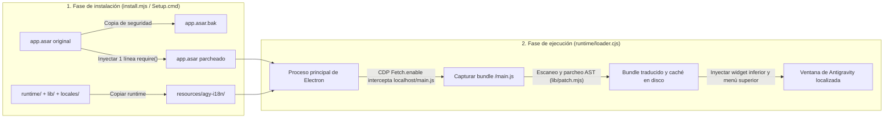

<div align="center">

# 🌐 Antigravity-i18n (`agy-i18n`)

**Parche de localización multilingüe y selector de idioma en tiempo real para el cliente de escritorio de Google Antigravity**  
*Multilingual UI Localization & Live Language Switcher for the Google Antigravity Desktop Client*

[](https://github.com/Violiate/Antigravity-i18n/actions/workflows/ci-release.yml)
[](https://github.com/Violiate/Antigravity-i18n/releases)
[](#supported-languages)
[](#supported-languages)
[](#quick-start-tutorial)
[](../LICENSE)

<p align="center">
  <b>🌍 Seleccionar idioma / Read in your language:</b><br>
  <a href="../README.md">English</a> ·
  <a href="./README.zh-CN.md">简体中文</a> ·
  <a href="./README.zh-TW.md">繁體中文</a> ·
  <a href="./README.ja.md">日本語</a> ·
  <a href="./README.ko.md">한국어</a> ·
  <strong>Español</strong> ·
  <a href="./README.fr.md">Français</a> ·
  <a href="./README.de.md">Deutsch</a> ·
  <a href="./README.pt-BR.md">Português (Brasil)</a> ·
  <a href="./README.ru.md">Русский</a>
</p>

</div>

---

## ✨ Descripción general

**Antigravity-i18n** proporciona localización multilingüe completa y cambio dinámico de idioma en la interfaz para el **cliente de escritorio de Google Antigravity**. Basado en un motor de escaneo y parcheo de AST (Árbol de Sintaxis Abstracta) mediante Acorn y un cargador ligero en tiempo de ejecución para Electron, traduce con total seguridad **2.175 cadenas de la interfaz de usuario** en **14 idiomas principales** de todo el mundo, sin romper la sintaxis de JavaScript ni alterar los datos del usuario.

- 🌍 **14 idiomas principales compatibles**: Diccionarios completos de 2.175 entradas para español (`es`), chino simplificado (`zh-CN`), chino tradicional (`zh-TW`), japonés (`ja`), coreano (`ko`), francés (`fr`), alemán (`de`), portugués de Brasil (`pt-BR`), ruso (`ru`), italiano (`it`), vietnamita (`vi`), turco (`tr`) y árabe (`ar`), además de acceso inmediato al inglés original (`en`).
- ⚡ **Cambio de idioma en tiempo real**: Cambie el idioma en cualquier momento desde el **selector flotante de la esquina inferior derecha**, el **menú superior de la ventana (`Language / 语言`)** o la **CLI**, recargando la interfaz al instante sin necesidad de reinstalar ni reiniciar el cliente por completo.
- 🪄 **Instalador gráfico para Windows sin dependencias (`Setup.cmd`)**: El paquete ZIP independiente para Windows incluye un entorno de ejecución oficial de Node.js fijado y verificado con SHA-256 junto con todas sus dependencias. **No se requiere Node.js, npm ni conexión a Internet.**
- 🛡️ **Seguro y reversible con 1 solo clic**: Crea automáticamente una copia de seguridad idéntica de su `app.asar` original en `app.asar.bak` antes de instalar. Restaure el cliente original en cualquier momento con un solo clic.
- 🌐 **Configuración de proxy segura para servicios locales**: Permite configurar de forma opcional un proxy HTTP/HTTPS con bypass automático para `localhost`, `127.0.0.1` y `[::1]`, garantizando que los Language Servers locales se comuniquen directamente sin interferencias.

---

<a id="quick-start-tutorial"></a>

## 🚀 Tutorial de inicio rápido

### Opción A: Instalador GUI de 1 clic para Windows (Recomendado — No requiere Node.js)

> **Resumen rápido**: Descargue `agy-i18n-1.1.0-windows-x64.zip` desde Releases -> **Extraiga la carpeta ZIP completa** -> Cierre Antigravity por completo (incluida la bandeja del sistema) -> Haga doble clic en **`Setup.cmd`** -> Seleccione el idioma y haga clic en **“Instalar / Actualizar (安装 / 更新)”**.

1. **Descargar el paquete de instalación**  
   Diríjase a la página de [**Releases**](https://github.com/Violiate/Antigravity-i18n/releases) y descargue el archivo `agy-i18n-1.1.0-windows-x64.zip` (junto con su archivo de comprobación `.sha256` si desea verificar la integridad).
2. **Extraer el archivo por completo**  
   **Extraiga el contenido completo del ZIP** en cualquier directorio de su equipo. *(No ejecute `Setup.cmd` directamente dentro de la vista previa del explorador de archivos comprimidos.)*
3. **Cerrar Antigravity por completo**  
   Guarde sus cambios y cierre el cliente de escritorio de Antigravity por completo (incluyendo el icono situado en la bandeja del sistema). El instalador detecta procesos en ejecución y nunca forzará el cierre de una sesión activa.
4. **Ejecutar `Setup.cmd`**  
   Haga doble clic en **`Setup.cmd`** dentro de la carpeta extraída para abrir el instalador gráfico:
   - **Directorio de Antigravity (`Antigravity 目录`)**: Se detecta automáticamente en rutas estándar. Si lo instaló en una ruta personalizada, haga clic en **“Examinar... (浏览...)”** y seleccione la carpeta de Antigravity o su subdirectorio `resources`.
   - **Idioma inicial de la interfaz (`初始界面语言`)**: Seleccione su idioma preferido (por ejemplo, `es` Español).
   - **Proxy opcional (`可选代理`)**: Déjelo en blanco si no lo necesita, o introduzca una dirección `http://` / `https://` (ej. `http://127.0.0.1:7890`). La configuración previa de proxy se preserva automáticamente.
   - Haga clic en **“Instalar / Actualizar (安装 / 更新)”**.
5. **Iniciar y disfrutar**  
   Abra Antigravity como de costumbre desde su acceso directo habitual y la interfaz se mostrará en su idioma.

---

### Opción B: Instalación desde el código fuente mediante CLI (Para desarrolladores)

#### 1. Requisitos previos
- **Node.js**: `>= 22.12.0`
- **Cliente de escritorio de Google Antigravity** (verificado en la versión para Windows `2.29.0`)

#### 2. Clonar el repositorio e instalar dependencias
```bash
git clone https://github.com/Violiate/Antigravity-i18n.git
cd Antigravity-i18n
npm install
```

#### 3. Aplicar el parche de localización
> [!IMPORTANT]
> Asegúrese de que el cliente de escritorio de Antigravity esté **completamente cerrado** antes de ejecutar `install` o `restore`.

```bash
# Instalación con idioma predeterminado (zh-CN)
npm run setup
# O equivalente: node install.mjs install

# Instalar especificando un idioma inicial (ej. español es, japonés ja, coreano ko)
node install.mjs install es
node install.mjs install ja
node install.mjs install ko
```

Si Antigravity está instalado en una ruta no predeterminada (por ejemplo `D:\Program Files\Antigravity`), agregue el argumento `--dir` o configure la variable de entorno `AGY_PATH`:

```bash
node install.mjs install --dir "D:\Program Files\Antigravity"
```

---

## 🔄 Cambio de idioma en tiempo real (3 métodos)

Una vez instalado, puede alternar entre los idiomas disponibles en cualquier momento sin volver a ejecutar el instalador:

1. **Selector flotante inferior derecho**  
   Haga clic en la pastilla flotante situada en la **esquina inferior derecha** de la ventana de Antigravity y seleccione cualquiera de los 14 idiomas.
2. **Barra de menú superior de la ventana**  
   Haga clic en **`Language / 语言`** en el menú de la aplicación y escoja el idioma deseado.
3. **Línea de comandos (`language.mjs`)**  
   ```bash
   # Listar todos los códigos de idioma disponibles
   node language.mjs list

   # Cambiar a cualquier idioma admitido
   node language.mjs es
   node language.mjs zh-TW
   node language.mjs zh-CN
   node language.mjs ja
   node language.mjs ko
   node language.mjs fr
   node language.mjs de
   node language.mjs pt-BR
   node language.mjs ru
   node language.mjs it
   node language.mjs vi
   node language.mjs tr
   node language.mjs ar
   node language.mjs en
   ```

> [!NOTE]
> Al cambiar de idioma se produce una recarga en la vista del renderizador (`reloadIgnoringCache`) para cargar de inmediato el nuevo paquete de scripts traducido. Asegúrese de guardar o enviar los borradores en curso antes de cambiar.

---

<a id="supported-languages"></a>

## 🌍 Idiomas compatibles

Los 13 diccionarios de traducción se encuentran en [`locales/`](../locales) y se validan en el pipeline de CI frente al analizador de sintaxis AST Acorn:

| Código (`locale`) | Nombre nativo | Nombre en inglés | Claves traducidas | Modo de ejecución |
| :--- | :--- | :--- | :--- | :--- |
| `en` | English | English (Original) | Paso directo | Interfaz original sin modificar |
| `es` | Español | Spanish | 2.175 | Parche dinámico AST |
| `zh-CN` | 简体中文 | Simplified Chinese | 2.175 | Parche dinámico AST |
| `zh-TW` | 繁體中文 | Traditional Chinese | 2.175 | Parche dinámico AST |
| `ja` | 日本語 | Japanese | 2.175 | Parche dinámico AST |
| `ko` | 한국어 | Korean | 2.175 | Parche dinámico AST |
| `fr` | Français | French | 2.175 | Parche dinámico AST |
| `de` | Deutsch | German | 2.175 | Parche dinámico AST |
| `pt-BR` | Português (Brasil) | Brazilian Portuguese | 2.175 | Parche dinámico AST |
| `ru` | Русский | Russian | 2.175 | Parche dinámico AST |
| `it` | Italiano | Italian | 2.175 | Parche dinámico AST |
| `vi` | Tiếng Việt | Vietnamese | 2.175 | Parche dinámico AST |
| `tr` | Türkçe | Turkish | 2.175 | Parche dinámico AST |
| `ar` | العربية | Arabic | 2.175 | Parche dinámico AST *(sin inversión de interfaz RTL)* |

---

## 🧠 Cómo funciona



1. **Gancho mínimo en el punto de entrada de ASAR**: Durante la instalación, `install.mjs` crea una copia de seguridad exacta byte a byte (`app.asar.bak`), descomprime `app.asar`, antepone una única línea `require('../agy-i18n/runtime/loader.cjs')` en `dist/main.js` y vuelve a empaquetar `app.asar`.
2. **Intercepción dinámica con CDP Fetch**: En tiempo de ejecución, `runtime/loader.cjs` se acopla a las `webContents.debugger` de cada ventana mediante el protocolo Chrome DevTools (`Fetch.enable`) e intercepta únicamente el script del renderizador local (`http://localhost:*/main.js`).
3. **Reemplazo seguro de cadenas mediante AST y caché**: `lib/scan.mjs` y `lib/patch.mjs` analizan el bundle con `acorn`, localizan las cadenas estáticas de la interfaz descartando identificadores o símbolos de código, sustituyen los textos por los correspondientes en `locales/<locale>.json`, comprueban que el árbol AST resultante sea válido y guardan el bundle parcheado en una caché de disco indexada por `(sha256, locale)`.

---

## ⚙️ Estado, restauración y configuración avanzada

### Comprobar estado o restaurar el cliente original
- **Desde la interfaz gráfica de Windows (`Setup.cmd`)**: Abra `Setup.cmd` y haga clic en **“Comprobar estado (检查状态)”** o **“Restaurar original (还原原版)”**.
- **Mediante la línea de comandos (CLI)**:
  ```bash
  # Ver el estado de la instalación, la ruta detectada y el idioma activo
  npm run status

  # Restaurar el archivo app.asar original sin modificaciones (cierre Antigravity antes)
  npm run restore
  ```

### Archivo de configuración en tiempo de ejecución (`config.json`)
Tras la instalación, los ajustes se guardan en `<Directorio de Antigravity>/resources/agy-i18n/config.json`:

```json
{
  "locale": "es",
  "proxy": "http://127.0.0.1:7890"
}
```

- `locale`: Código de idioma activo de la interfaz (`en`, `es`, `zh-CN`, `zh-TW`, `ja`, `ko`, `fr`, `de`, `pt-BR`, `ru`, `it`, `vi`, `tr`, `ar`).
- `proxy` *(opcional)*: Admite URLs de proxy con `http://` o `https://`. Configura el proxy global/de sesión en Electron aplicando automáticamente la regla de omisión `<local>;localhost;127.0.0.1;[::1]` para no interferir en la comunicación con los servidores locales.

---

## 📌 Alcance, limitaciones y preguntas frecuentes (FAQ)

- **¿Qué ocurre si Antigravity se actualiza y desaparece la traducción?**  
  Las actualizaciones del cliente sobreescriben `app.asar`. Simplemente cierre Antigravity, vuelva a abrir `Setup.cmd` (o ejecute `npm run setup`) y haga clic en **“Instalar / Actualizar”**. No existe ningún proceso demonio en segundo plano cuando Antigravity está cerrado.
- **¿Por qué algunas frases dinámicas siguen apareciendo en inglés?**  
  Solo se reemplazan de forma estática y segura las cadenas de la interfaz contenidas en el bundle local `/main.js` (2.175 claves). Los mensajes generados por servidores remotos, las plantillas ensambladas dinámicamente o los módulos cargados bajo demanda fuera de `/main.js` permanecen en inglés.
- **¿El árabe (`ar`) incluye adaptación de interfaz en espejo (RTL)?**  
  El diccionario en árabe contiene las 2.175 cadenas traducidas, pero por el momento no se aplica la inversión de diseño CSS de derecha a izquierda (RTL).
- **¿Windows SmartScreen muestra "Windows protegió su PC / Editor desconocido"?**  
  El paquete sin conexión distribuido no cuenta con un certificado de firma de código comercial. Haga clic en **“Más información” -> “Ejecutar de todas formas”**. La instalación en directorios de usuario habituales no requiere privilegios de administrador.
- **¿Es compatible con macOS o Linux?**  
  El instalador gráfico sin conexión (`Setup.cmd`) está diseñado específicamente para **Windows x64**. `lib/env.mjs` incorpora detección de rutas para macOS y Linux para experimentación en CLI, pero la verificación exhaustiva de extremo a extremo se ha realizado en Windows x64. Consulte [TESTING.md](../TESTING.md) para más detalles.

---

## 🧪 Pruebas, empaquetado y flujo de trabajo de CI/CD

Este repositorio cuenta con un flujo de trabajo automatizado en GitHub Actions ([`.github/workflows/ci-release.yml`](../.github/workflows/ci-release.yml)) que se ejecuta en cada push, pull request y etiqueta de versión `v*`:

1. **Pruebas unitarias e integridad de sintaxis AST (`npm test`)**: Valida los 13 archivos JSON de localización (2.175 claves cada uno) y ejecuta la verificación sintáctica del parcheo AST con Acorn en todos los idiomas.
2. **Empaquetado offline determinista para Windows (`npm run build:windows`)**: Descarga el paquete oficial de Node.js `v22.23.4` para Windows x64, verifica su suma SHA-256 (`cbc74b5e...`), recopila los archivos de runtime permitidos, genera el catálogo de hashes `MANIFEST.json` y emite `dist/agy-i18n-<version>-windows-x64.zip` junto a su archivo `.sha256`.
3. **Prueba de humo del paquete offline y GUI (`npm run test:package`)**: Aísla el entorno eliminando Node/npm del sistema, extrae el ZIP en una ruta con espacios y caracteres especiales, valida cada archivo contra `MANIFEST.json`, ejecuta el ciclo `discover -> install -> status -> repeat install -> restore` sobre un `app.asar` simulado y realiza un diagnóstico con `Setup.ps1 -SmokeTest`.
4. **Publicación automática en GitHub Releases**: Al enviar un tag que empiece por `v*` (por ejemplo, `git tag v1.1.0 && git push origin v1.1.0`), el flujo de trabajo publica automáticamente los artefactos verificados `.zip` y `.sha256` en GitHub Releases.

```bash
# Ejecutar pruebas unitarias y validación multilingüe AST
npm test

# Previsualizar el parcheo offline AST sobre un main.js capturado (si existe)
npm run preview:all

# Construir localmente el archivo ZIP independiente para Windows x64
npm run build:windows

# Ejecutar el conjunto completo de pruebas de regresión del paquete offline y la GUI
npm run test:package
```

---

## 🤝 Contribuir con traducciones

1. Los diccionarios de cada idioma se encuentran en [`locales/`](../locales) con la estructura `{ "Cadena original en inglés": "Cadena traducida" }`.
2. Los metadatos de los idiomas están registrados en [`locales/languages.json`](../locales/languages.json).
3. Tras modificar o añadir traducciones, ejecute `npm test` para verificar el formato JSON, asegurar que no existan valores vacíos y validar la seguridad de sintaxis AST antes de abrir un Pull Request.

---

## 📄 Licencia

Publicado bajo la [Licencia MIT](../LICENSE).
