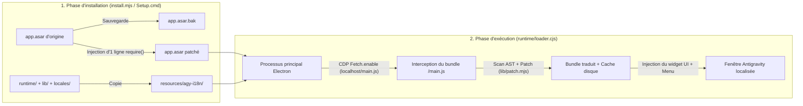

<div align="center">

# 🌐 Antigravity-i18n (`agy-i18n`)

**Localisation multilingue de l'interface et sélecteur de langue en direct pour le client de bureau Google Antigravity**  
*Multilingual UI Localization & Live Language Switcher for the Google Antigravity Desktop Client*

[](https://github.com/Violiate/Antigravity-i18n/actions/workflows/ci-release.yml)
[](https://github.com/Violiate/Antigravity-i18n/releases)
[](#supported-languages)
[](#supported-languages)
[](#quick-start-tutorial)
[](../LICENSE)

<p align="center">
  <b>🌍 Lire cette documentation dans votre langue :</b><br>
  <a href="../README.md">English</a> ·
  <a href="./README.zh-CN.md">简体中文</a> ·
  <a href="./README.zh-TW.md">繁體中文</a> ·
  <a href="./README.ja.md">日本語</a> ·
  <a href="./README.ko.md">한국어</a> ·
  <a href="./README.es.md">Español</a> ·
  <strong>Français</strong> ·
  <a href="./README.de.md">Deutsch</a> ·
  <a href="./README.pt-BR.md">Português (Brasil)</a> ·
  <a href="./README.ru.md">Русский</a>
</p>

</div>

---

## ✨ Aperçu

**Antigravity-i18n** apporte une localisation multilingue complète ainsi qu'un changement de langue instantané dans l'application pour le client de bureau **Google Antigravity**. Propulsé par un moteur d'analyse et de patch de chaînes basé sur l'arbre syntaxique abstrait (AST) Acorn et un chargeur d'exécution Electron ultra-léger, il traduit **2 175 chaînes d'interface** dans **14 langues mondiales majeures**, sans jamais corrompre la syntaxe JavaScript ni modifier vos données utilisateur.

- 🌍 **14 langues majeures** : Dictionnaires complets de 2 175 entrées pour le chinois simplifié (`zh-CN`), le chinois traditionnel (`zh-TW`), le japonais (`ja`), le coréen (`ko`), l'espagnol (`es`), le français (`fr`), l'allemand (`de`), le portugais brésilien (`pt-BR`), le russe (`ru`), l'italien (`it`), le vietnamien (`vi`), le turc (`tr`) et l'arabe (`ar`), avec retour direct sans modification à l'anglais d'origine (`en`).
- ⚡ **Changement de langue en direct** : Changez de langue à tout moment depuis le **sélecteur flottant en bas à droite**, le **menu supérieur de la fenêtre (`Language / 语言`)**, ou via la **ligne de commande (CLI)** — rafraîchit l'interface instantanément sans réinstallation.
- 🪄 **Installateur graphique Windows sans dépendance (`Setup.cmd`)** : L'archive ZIP autonome pour Windows intègre un runtime Node.js officiel vérifié par empreinte SHA-256 ainsi que toutes les dépendances requises. **Aucune installation de Node.js, npm, ni connexion Internet n'est nécessaire.**
- 🛡️ **Sécurisé et réversible en 1 clic** : Sauvegarde automatique de votre fichier original `app.asar` sous `app.asar.bak` avant toute modification. Restaurez le client d'origine intact à tout moment en un seul clic.
- 🌐 **Contournement sécurisé pour proxy local** : Configuration optionnelle de proxy HTTP/HTTPS qui contourne automatiquement `localhost`, `127.0.0.1` et `[::1]`, garantissant une connexion directe sans entrave aux serveurs de langage locaux (Language Servers).

---

<a id="quick-start-tutorial"></a>

## 🚀 Guide de démarrage rapide

### Option A : Installateur graphique Windows en 1 clic (Recommandé — Aucun Node.js requis)

> **Aperçu rapide** : Téléchargez `agy-i18n-1.1.0-windows-x64.zip` depuis les Releases -> **Extrayez entièrement l'archive ZIP** -> Quittez complètement Antigravity (y compris l'icône dans la barre des tâches) -> Double-cliquez sur **`Setup.cmd`** -> Choisissez votre langue et cliquez sur **« Installer / Mettre à jour »** !

1. **Télécharger le package de version**  
   Rendez-vous sur la page des [**Releases**](https://github.com/Violiate/Antigravity-i18n/releases) et téléchargez `agy-i18n-1.1.0-windows-x64.zip` (ainsi que son fichier de somme de contrôle `.sha256` si vous souhaitez vérifier l'intégrité de l'archive).
2. **Extraire l'archive**  
   **Extrayez l'intégralité du dossier ZIP** dans le répertoire de votre choix sur votre ordinateur. *(Ne double-cliquez pas directement sur `Setup.cmd` depuis la fenêtre de prévisualisation de l'archive non extraite.)*
3. **Fermer complètement Antigravity**  
   Enregistrez vos travaux en cours et quittez intégralement le client Antigravity (y compris son icône dans la zone de notification système). L'installateur vérifie la présence de processus actifs et ne fermera jamais brutalement votre session de travail.
4. **Exécuter `Setup.cmd`**  
   Double-cliquez sur **`Setup.cmd`** pour lancer l'interface graphique d'installation :
   - **Dossier d'installation (`Antigravity 目录`)** : Détecté automatiquement. Si votre client est installé dans un emplacement spécifique, cliquez sur **浏览... (Parcourir)** pour sélectionner le dossier Antigravity ou son sous-répertoire `resources`.
   - **Langue initiale (`初始界面语言`)** : Sélectionnez votre langue d'affichage préférée parmi les 14 langues prises en charge.
   - **Proxy optionnel (`可选代理`)** : Laissez vide si non requis, ou entrez un proxy `http://` / `https://` (ex. `http://127.0.0.1:7890`). Les réglages de proxy existants sont conservés automatiquement.
   - Cliquez sur **安装 / 更新 (Installer / Mettre à jour)**.
5. **Lancez et profitez !**  
   Démarrez Antigravity comme d'habitude depuis votre raccourci habituel.

---

### Option B : Installation depuis les sources via la CLI (Pour les développeurs)

#### 1. Prérequis
- **Node.js** : `>= 22.12.0`
- **Client de bureau Google Antigravity** (validé sur la version Windows `2.29.0`)

#### 2. Cloner le dépôt et installer les dépendances
```bash
git clone https://github.com/Violiate/Antigravity-i18n.git
cd Antigravity-i18n
npm install
```

#### 3. Appliquer le patch de localisation
> [!IMPORTANT]
> Assurez-vous que le client de bureau Antigravity est **complètement fermé** avant d'exécuter les commandes `install` ou `restore`.

```bash
# Installation avec la langue par défaut (zh-CN)
npm run setup
# Équivalent à : node install.mjs install

# Ou installation avec une langue initiale spécifique (ex. français, japonais, espagnol)
node install.mjs install fr
node install.mjs install ja
node install.mjs install es
```

Si Antigravity est installé dans un chemin personnalisé (par exemple `D:\Program Files\Antigravity`), transmettez l'option `--dir` ou définissez la variable d'environnement `AGY_PATH` :

```bash
node install.mjs install --dir "D:\Program Files\Antigravity"
```

---

## 🔄 Changement de langue en direct (3 méthodes)

Une fois l'installation terminée, vous pouvez basculer d'une langue d'affichage à l'autre à tout moment sans réexécuter l'installateur :

1. **Sélecteur de langue flottant en bas à droite**  
   Cliquez sur le badge de sélection de langue situé dans le **coin inférieur droit** de la fenêtre Antigravity et sélectionnez l'une des 14 langues.
2. **Barre de menu supérieure de l'application**  
   Cliquez sur **`Language / 语言`** dans la barre de menu supérieure de la fenêtre et choisissez votre langue cible.
3. **Ligne de commande (`language.mjs`)**  
   ```bash
   # Lister tous les codes de langue pris en charge
   node language.mjs list

   # Basculer vers n'importe quel code de langue pris en charge
   node language.mjs fr
   node language.mjs en
   node language.mjs zh-CN
   node language.mjs zh-TW
   node language.mjs ja
   node language.mjs ko
   node language.mjs es
   node language.mjs de
   node language.mjs pt-BR
   node language.mjs ru
   node language.mjs it
   node language.mjs vi
   node language.mjs tr
   node language.mjs ar
   ```

> [!NOTE]
> Le changement de langue déclenche un rechargement du moteur de rendu (`reloadIgnoringCache`) afin que le nouveau script traduit prenne effet immédiatement. Veuillez enregistrer ou soumettre vos messages ou saisies en cours avant de basculer.

---

<a id="supported-languages"></a>

## 🌍 Langues prises en charge

L'ensemble des 13 dictionnaires de traduction réside dans [`locales/`](../locales) et fait l'objet d'une validation rigoureuse par le patcheur AST Acorn dans la CI :

| Code (`locale`) | Nom autochtone | Nom en anglais | Clés traduites | Mode |
| :--- | :--- | :--- | :--- | :--- |
| `en` | English | English (Original) | Pass-through direct | Interface anglaise d'origine non modifiée |
| `zh-CN` | 简体中文 | Simplified Chinese | 2 175 | Patch dynamique AST |
| `zh-TW` | 繁體中文 | Traditional Chinese | 2 175 | Patch dynamique AST |
| `ja` | 日本語 | Japanese | 2 175 | Patch dynamique AST |
| `ko` | 한국어 | Korean | 2 175 | Patch dynamique AST |
| `es` | Español | Spanish | 2 175 | Patch dynamique AST |
| `fr` | Français | French | 2 175 | Patch dynamique AST |
| `de` | Deutsch | German | 2 175 | Patch dynamique AST |
| `pt-BR` | Português (Brasil) | Brazilian Portuguese | 2 175 | Patch dynamique AST |
| `ru` | Русский | Russian | 2 175 | Patch dynamique AST |
| `it` | Italiano | Italian | 2 175 | Patch dynamique AST |
| `vi` | Tiếng Việt | Vietnamese | 2 175 | Patch dynamique AST |
| `tr` | Türkçe | Turkish | 2 175 | Patch dynamique AST |
| `ar` | العربية | Arabic | 2 175 | Patch dynamique AST *(disposition LTR)* |

---

## 🧠 Fonctionnement interne



1. **Accroche minimale dans l'ASAR** : Lors de l'installation, `install.mjs` crée une copie conforme à l'octet près (`app.asar.bak`), décompresse `app.asar`, insère une unique ligne `require('../agy-i18n/runtime/loader.cjs')` au début de `dist/main.js`, puis recompresse `app.asar`.
2. **Interception CDP Fetch** : Au démarrage, `runtime/loader.cjs` s'attache au `webContents.debugger` de chaque fenêtre via le protocole Chrome DevTools (`Fetch.enable`) et intercepte uniquement le script de rendu local (`http://localhost:*/main.js`).
3. **Remplacement de chaînes sécurisé par AST & mise en cache** : `lib/scan.mjs` et `lib/patch.mjs` analysent le code JavaScript avec `acorn`, identifient les chaînes littérales d'affichage de l'interface tout en ignorant les identifiants de code et tokens internes, remplacent les chaînes correspondantes depuis `locales/<locale>.json`, vérifient la validité syntaxique de l'AST résultant, et mettent en cache le script patché sur le disque indexé par `(sha256, locale)`.

---

## ⚙️ État, restauration et configuration avancée

### Vérifier l'état ou restaurer le client d'origine
- **Via l'interface graphique Windows (`Setup.cmd`)** : Lancez `Setup.cmd` et cliquez sur **检查状态 (Vérifier l'état)** ou **还原原版 (Restaurer l'original)**.
- **Via la ligne de commande (CLI)** :
  ```bash
  # Afficher l'état de l'installation, le chemin détecté et la langue active
  npm run status

  # Restaurer le fichier original app.asar intact (fermez Antigravity au préalable)
  npm run restore
  ```

### Configuration d'exécution (`config.json`)
Après l'installation, les réglages d'exécution sont stockés dans `<Antigravity>/resources/agy-i18n/config.json` :

```json
{
  "locale": "fr",
  "proxy": "http://127.0.0.1:7890"
}
```

- `locale` : Code de langue actif de l'interface (`en`, `zh-CN`, `zh-TW`, `ja`, `ko`, `es`, `fr`, `de`, `pt-BR`, `ru`, `it`, `vi`, `tr`, `ar`).
- `proxy` *(optionnel)* : Accepte les URLs de proxy en `http://` ou `https://`. Configure automatiquement le proxy de session/global d'Electron tout en imposant les règles de contournement `<local>;localhost;127.0.0.1;[::1]`.

---

## 📌 Portée, limites et FAQ

- **Que se passe-t-il si Antigravity se met à jour et que ma traduction disparaît ?**  
  Les mises à jour du client écrasent `app.asar`. Il suffit de fermer Antigravity, de lancer `Setup.cmd` (ou `npm run setup`), et de cliquer à nouveau sur **Installer / Mettre à jour**. Aucun service en arrière-plan ne s'exécute lorsque Antigravity est fermé.
- **Pourquoi certaines phrases dynamiques restent-elles en anglais ?**  
  Seules les chaînes statiques d'interface contenues dans le bundle local `/main.js` (2 175 clés) sont patchées. Les réponses générées par le serveur, les modèles dynamiques ou les modules chargés à la demande hors de `/main.js` restent en anglais.
- **L'arabe (`ar`) inclut-il une inversion de mise en page RTL (de droite à gauche) ?**  
  Le dictionnaire arabe contient bien l'ensemble des 2 175 chaînes traduites, mais l'adaptation complète de la feuille de style CSS de droite à gauche (RTL) n'est pas encore appliquée.
- **Windows SmartScreen indique « Windows a protégé votre ordinateur / Éditeur inconnu » ?**  
  Le package autonome hors ligne n'est pas signé avec un certificat payant de signature de code commercial. Cliquez sur **Informations complémentaires** -> **Exécuter quand même**.
- **macOS et Linux sont-ils pris en charge ?**  
  Le package hors ligne avec interface graphique (`Setup.cmd`) cible **Windows x64**. Le script `lib/env.mjs` inclut les routines de détection de chemin pour macOS et Linux pour l'expérimentation en ligne de commande, mais seul Windows x64 a été validé de bout en bout. Consultez [TESTING.md](../TESTING.md) pour plus de détails.

---

## 🧪 Tests, empaquetage et pipeline CI/CD

Ce dépôt intègre un flux de travail automatisé GitHub Actions ([`.github/workflows/ci-release.yml`](../.github/workflows/ci-release.yml)) qui s'exécute à chaque push, pull request et tag de version `v*` :

1. **Tests unitaires et d'intégrité AST (`npm test`)** : Valide l'ensemble des 13 fichiers JSON de langues (2 175 clés chacun) et exécute la vérification syntaxique du scan/patch AST Acorn sur chaque langue.
2. **Empaquetage hors ligne Windows déterministe (`npm run build:windows`)** : Télécharge l'archive officielle de Node.js `v22.23.4` Windows x64, vérifie son empreinte SHA-256 figée (`cbc74b5e...`), prépare une liste blanche stricte des fichiers d'exécution, génère `MANIFEST.json`, et produit `dist/agy-i18n-<version>-windows-x64.zip` + `.sha256`.
3. **Tests de régression et de fumée du package hors ligne & de l'IHM (`npm run test:package`)** : Supprime le Node/npm de développement de la variable `PATH`, extrait le ZIP produit dans un chemin contenant des espaces et des caractères Unicode, vérifie le hachage de chaque fichier par rapport au `MANIFEST.json`, exécute `discover -> install -> status -> repeat install -> restore` contre un `app.asar` témoin, et lance `Setup.ps1 -SmokeTest`.
4. **Publication automatique des Releases GitHub** : La publication d'un tag correspondant à `v*` (ex. `git tag v1.1.0 && git push origin v1.1.0`) déclenche la mise en ligne automatique du `.zip` et du `.sha256` vérifiés sur GitHub Releases.

```bash
# Exécuter les tests unitaires et de validation syntaxique multilingue AST
npm test

# Prévisualiser le patch AST hors ligne sur un main.js capturé (si présent)
npm run preview:all

# Construire localement le package ZIP autonome Windows x64
npm run build:windows

# Lancer la suite complète de tests de régression hors ligne et d'IHM
npm run test:package
```

---

## 🤝 Contribuer aux traductions

1. Les dictionnaires de langues sont stockés dans [`locales/`](../locales) sous la forme `{ "Original English String": "Chaîne traduite" }`.
2. Les métadonnées des langues sont enregistrées dans [`locales/languages.json`](../locales/languages.json).
3. Après avoir modifié ou ajouté des traductions, exécutez `npm test` pour vérifier le formatage JSON, l'absence de valeurs vides et la validité syntaxique de l'AST avant d'ouvrir une Pull Request.

---

## 📄 Licence

Publié sous la licence [MIT License](../LICENSE).
