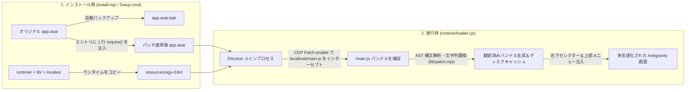

<div align="center">

# 🌐 Antigravity-i18n (`agy-i18n`)

**Google Antigravity デスクトップクライアント向け多言語ローカライズパッチ＆リアルタイム言語切替ツール**  
*Multilingual UI Localization & Live Language Switcher for the Google Antigravity Desktop Client*

[](https://github.com/Violiate/Antigravity-i18n/actions/workflows/ci-release.yml)
[](https://github.com/Violiate/Antigravity-i18n/releases)
[](#supported-languages)
[](#supported-languages)
[](#quick-start-tutorial)
[](../LICENSE)

<p align="center">
  <b>🌍 言語を選択 / Read in your language:</b><br>
  <a href="../README.md">English</a> ·
  <a href="./README.zh-CN.md">简体中文</a> ·
  <a href="./README.zh-TW.md">繁體中文</a> ·
  <strong>日本語</strong> ·
  <a href="./README.ko.md">한국어</a> ·
  <a href="./README.es.md">Español</a> ·
  <a href="./README.fr.md">Français</a> ·
  <a href="./README.de.md">Deutsch</a> ·
  <a href="./README.pt-BR.md">Português (Brasil)</a> ·
  <a href="./README.ru.md">Русский</a>
</p>

</div>

---

## ✨ 概要

**Antigravity-i18n** は、**Google Antigravity デスクトップクライアント** のための多言語ローカライズおよびリアルタイム言語切替ツールです。Acorn AST（抽象構文木）スキャン/パッチエンジンと軽量な Electron ランタイムローダーをベースに構築されており、JavaScript の構文やユーザーデータを破損することなく、**14 言語**にわたる **2,175 箇所の UI 文字列** を安全に翻訳します。

- 🌍 **14 の主要言語に対応**: 日本語 (`ja`)、簡体字中国語 (`zh-CN`)、繁体字中国語 (`zh-TW`)、韓国語 (`ko`)、スペイン語 (`es`)、フランス語 (`fr`)、ドイツ語 (`de`)、ブラジルポルトガル語 (`pt-BR`)、ロシア語 (`ru`)、イタリア語 (`it`)、ベトナム語 (`vi`)、トルコ語 (`tr`)、アラビア語 (`ar`) の計 13 言語（各 2,175 キー）の完全な辞書を完備し、いつでも元の英語 (`en`) に即座に戻せます。
- ⚡ **リアルタイム言語切り替え**: ウィンドウ**右下のフローティングセレクター**、**トップウィンドウメニュー (`Language / 言語`)**、または **CLI** からいつでも言語を切り替え可能。再インストール不要でその場で UI が自動更新されます。
- 🪄 **依存関係ゼロの Windows GUI インストーラー (`Setup.cmd`)**: Windows 向けスタンドアロン Release ZIP には、SHA-256 検証済みの公式 Node.js ランタイムと全依存パッケージが同梱されています。**Node.js や npm の事前インストール、インターネット接続は一切不要です。**
- 🛡️ **安全＆ワンクリックで復元可能**: インストール時にオリジナルの `app.asar` を自動的に `app.asar.bak` へバックアップ。ワンクリックでバイト単位で完全に元のクライアント状態へ復元できます。
- 🌐 **ローカルサーバー直結を保証するプロキシ設定**: 任意の HTTP/HTTPS プロキシ設定に対応し、`localhost`、`127.0.0.1`、`[::1]` は自動的にバイパスされるため、ローカル言語サーバー (Language Server) の通信を妨げません。

---

<a id="quick-start-tutorial"></a>

## 🚀 クイックスタートガイド

### 方法 A: Windows 向け 1 クリック GUI インストーラー（推奨・Node.js 不要）

> **クイックサマリー**: Releases から `agy-i18n-1.1.0-windows-x64.zip` をダウンロード -> **フォルダごとすべて解凍** -> Antigravity を完全に終了（タスクトレイ含む） -> **`Setup.cmd`** をダブルクリック -> 言語を選択して **「インストール / 更新 (Install / Update)」** をクリックするだけです！

1. **リリースパッケージのダウンロード**  
   GitHub の [**Releases ページ**](https://github.com/Violiate/Antigravity-i18n/releases) から最新の `agy-i18n-1.1.0-windows-x64.zip` をダウンロードします（整合性を確認したい場合は `.sha256` も併せてダウンロードしてください）。
2. **アーカイブの完全展開**  
   ZIP ファイルを任意のフォルダに**すべて解凍**します（※ZIP プレビュー画面から直接 `Setup.cmd` を実行しないでください）。
3. **Antigravity を完全に終了**  
   作業中のファイルを保存し、Antigravity クライアントを完全に終了します（タスクトレイのアイコンも右クリックから終了してください）。インストーラーは実行中のプロセスを自動検出するため、作業セッションが強制終了されることはありません。
4. **`Setup.cmd` を実行**  
   解凍先にある **`Setup.cmd`** をダブルクリックして GUI インストーラーを起動します:
   - **Antigravity ディレクトリ (`Antigravity 目录`)**: 通常は自動検出されます。カスタムパスにインストールしている場合は、**「参照... (浏览...)」** をクリックして Antigravity のフォルダまたは `resources` サブディレクトリを選択してください。
   - **初期表示言語 (`初始界面语言`)**: 14 言語の中からお好みの表示言語（例: `ja` 日本語）を選択します。
   - **プロキシ設定 (`可选代理`)**: 不要な場合は空欄のままで構いません。必要な場合は `http://127.0.0.1:7890` などの形式で入力します（既存の設定がある場合は自動で引き継がれます）。
   - **「インストール / 更新 (安装 / 更新)」** をクリックします。
5. **起動して利用開始！**  
   通常通りショートカットから Antigravity を起動すると、多言語 UI が適用されます。

---

### 方法 B: CLI ソースコードからのインストール（開発者向け）

#### 1. 前提条件
- **Node.js**: `>= 22.12.0`
- **Google Antigravity デスクトップクライアント**（Windows 版 `2.29.0` にて検証済み）

#### 2. リポジトリのクローンと依存関係のインストール
```bash
git clone https://github.com/Violiate/Antigravity-i18n.git
cd Antigravity-i18n
npm install
```

#### 3. ローカライズパッチの適用
> [!IMPORTANT]
> `install` や `restore` を実行する前に、必ず Antigravity クライアントを**完全に終了**してください。

```bash
# デフォルト言語（簡体字中国語 zh-CN）でインストール
npm run setup
# または: node install.mjs install

# 初期言語を指定してインストール（日本語 ja、繁体字中国語 zh-TW、韓国語 ko など）
node install.mjs install ja
node install.mjs install zh-TW
node install.mjs install ko
```

デフォルト以外の場所（例: `D:\Program Files\Antigravity`）にインストールされている場合は、`--dir` オプションまたは `AGY_PATH` 環境変数を指定してください:

```bash
node install.mjs install --dir "D:\Program Files\Antigravity"
```

---

## 🔄 リアルタイム言語切り替え（3 つの方法）

インストール後は、インストーラーを再実行することなく、いつでも表示言語を切り替えることができます:

1. **右下のフローティング言語セレクター**  
   Antigravity ウィンドウ**右下のフローティングピル**をクリックし、14 言語から切り替えたい言語を選択します。
2. **ウィンドウ上部メニューバー**  
   上部メニューの **`Language / 语言`** をクリックし、対象の言語を選択します。
3. **コマンドラインツール (`language.mjs`)**  
   ```bash
   # 利用可能な言語コード一覧を表示
   node language.mjs list

   # 目的の言語コードへ切り替え
   node language.mjs ja
   node language.mjs zh-TW
   node language.mjs zh-CN
   node language.mjs ko
   node language.mjs es
   node language.mjs fr
   node language.mjs de
   node language.mjs pt-BR
   node language.mjs ru
   node language.mjs it
   node language.mjs vi
   node language.mjs tr
   node language.mjs ar
   node language.mjs en
   ```

> [!NOTE]
> 言語切り替えを行うと、新言語のスクリプトバンドルを即座に反映させるためレンダラーのリロード（`reloadIgnoringCache`）が実行されます。切り替え前に入力フォームの保存や送信を行ってください。

---

<a id="supported-languages"></a>

## 🌍 対応言語一覧

13 言語すべての翻訳辞書は [`locales/`](../locales) ディレクトリに格納されており、CI において Acorn AST パッチャーによる構文検証が行われています:

| 言語コード (`locale`) | 現地名 (Native) | 英語名 (English) | 翻訳キー数 | 動作モード |
| :--- | :--- | :--- | :--- | :--- |
| `en` | English | English (Original) | パススルー | 未変更のオリジナル UI |
| `ja` | 日本語 | Japanese | 2,175 | AST 動的パッチ |
| `zh-CN` | 简体中文 | Simplified Chinese | 2,175 | AST 動的パッチ |
| `zh-TW` | 繁體中文 | Traditional Chinese | 2,175 | AST 動的パッチ |
| `ko` | 한국어 | Korean | 2,175 | AST 動的パッチ |
| `es` | Español | Spanish | 2,175 | AST 動的パッチ |
| `fr` | Français | French | 2,175 | AST 動的パッチ |
| `de` | Deutsch | German | 2,175 | AST 動的パッチ |
| `pt-BR` | Português (Brasil) | Brazilian Portuguese | 2,175 | AST 動的パッチ |
| `ru` | Русский | Russian | 2,175 | AST 動的パッチ |
| `it` | Italiano | Italian | 2,175 | AST 動的パッチ |
| `vi` | Tiếng Việt | Vietnamese | 2,175 | AST 動的パッチ |
| `tr` | Türkçe | Turkish | 2,175 | AST 動的パッチ |
| `ar` | العربية | Arabic | 2,175 | AST 動的パッチ *(RTL ミラー配置未適用)* |

---

## 🧠 動作原理



1. **最小限の ASAR エントリフック**: インストール時、`install.mjs` は元のファイルを `app.asar.bak` へ正確にバックアップした上で、`app.asar` を展開し、`dist/main.js` の先頭に `require('../agy-i18n/runtime/loader.cjs')` の 1 行のみを注入して再パッケージ化します。
2. **CDP Fetch による動的インターセプト**: アプリ実行時、`runtime/loader.cjs` は Chrome DevTools Protocol (`Fetch.enable`) を介して各ウィンドウの `webContents.debugger` にアタッチし、ローカルのレンダラースクリプト（`http://localhost:*/main.js`）のみをピンポイントで捕捉します。
3. **AST レベルの安全な文字列置換とキャッシュ**: `lib/scan.mjs` と `lib/patch.mjs` が `acorn` を用いて JS バンドルを解析し、プログラムコードの識別子や内部シンボルを避けて表示用 UI 文字列のみを `locales/<locale>.json` の翻訳値に置換します。置換後の構文妥当性を検証後、`(sha256, locale)` をキーとしてディスクへキャッシュします。

---

## ⚙️ 状態確認・ワンクリック復元・高度な設定

### 状態確認と元に戻す (復元)
- **Windows GUI (`Setup.cmd`) の場合**: `Setup.cmd` を開き、**「状態確認 (检查状态)」** または **「元に戻す (还原原版)」** をクリックします。
- **CLI の場合**:
  ```bash
  # 現在のインストール状態、検出パス、アクティブな言語を確認
  npm run status

  # Antigravity を完全に終了した状態で、元の未変更 app.asar に復元
  npm run restore
  ```

### ランタイム設定ファイル (`config.json`)
インストール完了後、設定内容は `<Antigravity インストール先>/resources/agy-i18n/config.json` に保存されます:

```json
{
  "locale": "ja",
  "proxy": "http://127.0.0.1:7890"
}
```

- `locale`: 現在有効な UI 言語コード（`en`, `ja`, `zh-TW`, `zh-CN`, `ko`, `es`, `fr`, `de`, `pt-BR`, `ru`, `it`, `vi`, `tr`, `ar`）。
- `proxy`（任意）: `http://` または `https://` 形式のプロキシ URL。設定すると Electron のセッション/グローバルプロキシに適用されつつ、`<local>;localhost;127.0.0.1;[::1]` は確実に直接接続（バイパス）されます。

---

## 📌 よくある質問と制限事項 (FAQ)

- **Antigravity の自動アップデート後に翻訳が消えた場合は？**  
  クライアントのアップデートにより `app.asar` が上書きされます。Antigravity を完全に終了してから、再度 `Setup.cmd`（または `npm run setup`）を実行し、**「インストール / 更新」** をクリックするだけで元通りになります。バックグラウンドで常駐するデーモン等はありません。
- **一部の文章が英語のまま表示されるのはなぜですか？**  
  ローカルの `/main.js` に含まれる静的 UI 文字列（計 2,175 項目）のみを対象に安全な置換を行っています。サーバーから動的に受信するメッセージ、動的に組み立てられるテンプレート、あるいは遅延読み込みされる別モジュールなどは置換対象外となります。
- **アラビア語 (`ar`) は右から左 (RTL) のミラー配置に対応していますか？**  
  アラビア語辞書には 2,175 項目すべての翻訳が含まれていますが、現バージョンでは CSS による完全な RTL ミラーレイアウト変換は適用されません。
- **Windows SmartScreen で「Windows によって PC が保護されました / 不明な発行元」と表示される場合は？**  
  スタンドアロンのオフラインパッケージには高額な商用コード署名証明書が付与されていないためです。**「詳細情報」 -> 「実行」** をクリックしてください。通常のユーザーディレクトリへのインストールには管理者権限は不要です。
- **macOS や Linux はサポートされていますか？**  
  ビルド済みのオフライン GUI パッケージ (`Setup.cmd`) は **Windows x64** 専用です。`lib/env.mjs` には macOS / Linux 向けのパス検出ロジックが含まれており CLI での実験は可能ですが、エンドツーエンドの動作検証が完了しているのは Windows x64 のみです。詳しくは [TESTING.md](../TESTING.md) をご覧ください。

---

## 🧪 テスト・ビルド・GitHub Actions CI/CD パイプライン

本リポジトリには、プッシュ、プルリクエスト、および `v*` バージョンタグで自動実行される包括的な GitHub Actions ワークフロー（[`.github/workflows/ci-release.yml`](../.github/workflows/ci-release.yml)）が組み込まれています:

1. **ユニットテスト＆全言語 AST 整合性検証 (`npm test`)**: 13 言語すべての辞書 JSON（各 2,175 キー）の整合性を検証し、Acorn AST スキャン/パッチによる構文チェックを行います。
2. **決定論的 Windows オフラインパッケージのビルド (`npm run build:windows`)**: 公式 Node.js `v22.23.4` Windows x64 アーカイブを取得して SHA-256（`cbc74b5e...`）を検証し、厳密なホワイトリストに基づいてランタイムと辞書をパッケージング。`dist/agy-i18n-<version>-windows-x64.zip`、`.sha256`、および各ファイルハッシュを記載した `MANIFEST.json` を出力します。
3. **オフラインパッケージ＆GUI スモークテスト (`npm run test:package`)**: 開発用 Node/npm 環境変数を一時除去したクリーンな状態で ZIP を展開し、`MANIFEST.json` との全ファイルハッシュ照合、モック `app.asar` に対する `discover -> install -> status -> 連続 install -> restore` のバイト単位復元検証、および `Setup.ps1 -SmokeTest` GUI 自己診断を実行します。
4. **自動 GitHub Releases 発行**: `v*` 形式のタグ（例: `git tag v1.1.0 && git push origin v1.1.0`）をプッシュすると、検証済みの `.zip` と `.sha256` が GitHub Releases に自動公開されます。

```bash
# ユニットテストおよび多言語 AST 検証を実行
npm test

# 取得した main.js に対するオフライン AST パッチ結果をプレビュー（存在する場合）
npm run preview:all

# スタンドアロン Windows x64 ZIP パッケージをローカルでビルド
npm run build:windows

# オフラインパッケージおよび GUI の回帰テストスイートを実行
npm run test:package
```

---

## 🤝 翻訳への貢献

1. 各言語の辞書ファイルは [`locales/`](../locales) ディレクトリに `{ "英語の原文": "翻訳文字列" }` の形式で保存されています。
2. 言語のメタデータは [`locales/languages.json`](../locales/languages.json) に登録されています。
3. 翻訳の修正や新規追加を行った後は、`npm test` を実行して JSON のフォーマット、空文字がないこと、AST 構文の妥当性を確認した上で Pull Request を作成してください。

---

## 📄 ライセンス

本プロジェクトは [MIT License](../LICENSE) のもとで公開されています。
