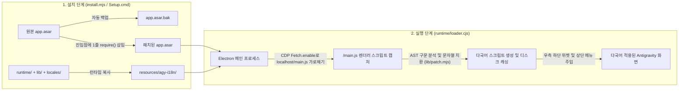

<div align="center">

# 🌐 Antigravity-i18n (`agy-i18n`)

**Google Antigravity 데스크톱 클라이언트를 위한 다국어 현지화 패치 및 실시간 언어 전환 도구**  
*Multilingual UI Localization & Live Language Switcher for the Google Antigravity Desktop Client*

[](https://github.com/Violiate/Antigravity-i18n/actions/workflows/ci-release.yml)
[](https://github.com/Violiate/Antigravity-i18n/releases)
[](#supported-languages)
[](#supported-languages)
[](#quick-start-tutorial)
[](../LICENSE)

<p align="center">
  <b>🌍 문서 언어 선택 / Read in your language:</b><br>
  <a href="../README.md">English</a> ·
  <a href="./README.zh-CN.md">简体中文</a> ·
  <a href="./README.zh-TW.md">繁體中文</a> ·
  <a href="./README.ja.md">日本語</a> ·
  <strong>한국어</strong> ·
  <a href="./README.es.md">Español</a> ·
  <a href="./README.fr.md">Français</a> ·
  <a href="./README.de.md">Deutsch</a> ·
  <a href="./README.pt-BR.md">Português (Brasil)</a> ·
  <a href="./README.ru.md">Русский</a>
</p>

</div>

---

## ✨ 개요

**Antigravity-i18n**은 **Google Antigravity 데스크톱 클라이언트**를 위한 종합 다국어 현지화 및 실시간 언어 전환 도구입니다. Acorn AST(추상 구문 트리) 스캔/패치 엔진과 초경량 Electron 런타임 로더를 기반으로 제작되어, JavaScript 문법 구조나 사용자 데이터를 손상시키지 않고 **14개 주요 세계 언어**에 걸쳐 **2,175개의 UI 문자열**을 안전하게 번역합니다.

- 🌍 **14개 주요 언어 완벽 지원**: 한국어(`ko`), 중국어 간체(`zh-CN`), 중국어 번체(`zh-TW`), 일본어(`ja`), 스페인어(`es`), 프랑스어(`fr`), 독일어(`de`), 브라질 포르투갈어(`pt-BR`), 러시아어(`ru`), 이탈리아어(`it`), 베트남어(`vi`), 튀르키예어(`tr`), 아랍어(`ar`) 등 총 13개 언어(각 2,175개 키)의 완전한 사전과 원본 영어(`en`) 즉시 복귀를 지원합니다.
- ⚡ **앱 내 실시간 언어 전환**: 창 **우측 하단의 플로팅 선택기**, **상단 창 메뉴 (`Language / 语言`)** 또는 **CLI**를 통해 언제든지 언어를 변경할 수 있으며, 재설치 없이 즉시 UI가 새로고침됩니다.
- 🪄 **외부 의존성 제로 Windows 1-클릭 GUI 설치 프로그램 (`Setup.cmd`)**: 독립형 Windows 릴리스 ZIP에는 SHA-256 검증을 거친 공식 고정 버전 Node.js 런타임과 모든 필수 의존성이 포함되어 있습니다. **Node.js, npm 사전 설치나 인터넷 연결이 전혀 필요하지 않습니다.**
- 🛡️ **안전하며 1-클릭 원상 복원 지원**: 설치 시 원본 `app.asar`을 `app.asar.bak`으로 자동 백업합니다. 언제든 단 한 번의 클릭으로 바이트 단위까지 일치하는 원본 클라이언트로 완벽하게 복원할 수 있습니다.
- 🌐 **로컬 서비스 안전 프록시 우회**: 선택적 HTTP/HTTPS 프록시 설정을 지원하며, `localhost`, `127.0.0.1`, `[::1]`은 자동으로 우회(직접 연결) 처리되어 로컬 언어 서버(Language Server)와의 통신을 방해하지 않습니다.

---

<a id="quick-start-tutorial"></a>

## 🚀 빠른 시작 가이드

### 방법 A: Windows 1-클릭 GUI 설치 프로그램 (권장 — Node.js 불필요)

> **요약**: GitHub Releases에서 `agy-i18n-1.1.0-windows-x64.zip` 다운로드 -> **전체 압축 풀기** -> Antigravity 완전 종료(트레이 아이콘 포함) -> **`Setup.cmd`** 더블 클릭 -> 언어 선택 후 **“설치 / 업데이트 (安装 / 更新)”** 클릭!

1. **릴리스 패키지 다운로드**  
   GitHub [**Releases 페이지**](https://github.com/Violiate/Antigravity-i18n/releases)에서 최신 `agy-i18n-1.1.0-windows-x64.zip`을 다운로드합니다(무결성 검증을 원하는 경우 `.sha256` 파일도 함께 다운로드).
2. **압축 완전히 해제**  
   ZIP 압축 파일을 임의의 디렉터리에 **모두 압축 해제**합니다. *(압축 프로그램 미리보기 창 내에서 `Setup.cmd`를 직접 실행하지 마세요.)*
3. **Antigravity 클라이언트 완전 종료**  
   작업 중인 내용을 저장하고 Antigravity 클라이언트를 완전히 종료합니다(작업 표시줄 우측 시스템 트레이 아이콘도 종료). 설치 프로그램이 실행 중인 프로세스를 감지하므로 작업 세션이 강제 종료되지 않습니다.
4. **`Setup.cmd` 실행**  
   압축을 푼 폴더에서 **`Setup.cmd`**를 더블 클릭하여 GUI 설치 프로그램을 실행합니다:
   - **Antigravity 디렉터리 (`Antigravity 目录`)**: 기본 설치 경로를 자동으로 감지합니다. 사용자 지정 위치에 설치된 경우 **“찾아보기... (浏览...)”**를 클릭하여 Antigravity 설치 폴더 또는 하위 `resources` 폴더를 선택합니다.
   - **초기 UI 언어 (`初始界面语言`)**: 14개 지원 언어 중 원하는 언어(예: 한국어 `ko`)를 선택합니다.
   - **프록시 설정 (`可选代理`)**: 필요 없으면 비워두고, 프록시가 필요한 경우 `http://127.0.0.1:7890` 형식으로 입력합니다(기존 설정은 자동으로 보존됩니다).
   - **“설치 / 업데이트 (安装 / 更新)”** 버튼을 클릭합니다.
5. **클라이언트 실행 및 사용**  
   바탕화면이나 시작 메뉴의 바로가기에서 Antigravity를 평소처럼 실행하면 다국어 UI가 적용됩니다!

---

### 방법 B: 개발자용 소스 코드 / CLI 설치

#### 1. 필수 환경
- **Node.js**: `>= 22.12.0`
- **Google Antigravity 데스크톱 클라이언트** (Windows 클라이언트 `2.29.0`에서 검증 완료)

#### 2. 저장소 복제 및 의존성 설치
```bash
git clone https://github.com/Violiate/Antigravity-i18n.git
cd Antigravity-i18n
npm install
```

#### 3. 현지화 패치 적용
> [!IMPORTANT]
> `install` 또는 `restore`를 실행하기 전에 반드시 Antigravity 클라이언트를 **완전히 종료**해야 합니다.

```bash
# 기본 언어(중국어 간체 zh-CN)로 설치
npm run setup
# 또는: node install.mjs install

# 원하는 초기 언어를 지정하여 설치 (예: 한국어 ko, 일본어 ja, 번체 zh-TW)
node install.mjs install ko
node install.mjs install ja
node install.mjs install zh-TW
```

Antigravity가 기본 경로가 아닌 위치(예: `D:\Program Files\Antigravity`)에 설치되어 있는 경우 `--dir` 매개변수나 `AGY_PATH` 환경 변수로 지정하세요:

```bash
node install.mjs install --dir "D:\Program Files\Antigravity"
```

---

## 🔄 실시간 언어 전환 (3가지 방법)

설치 후에는 설치 프로그램을 다시 실행하지 않고도 언제든지 화면 표시 언어를 변경할 수 있습니다:

1. **우측 하단 플로팅 언어 선택기**  
   Antigravity 창 **우측 하단 모서리의 플로팅 알약 버튼**을 클릭하여 14개 언어 중 원하는 언어를 선택합니다.
2. **상단 창 메뉴 모음**  
   상단 메뉴 모음의 **`Language / 语言`** 메뉴를 클릭하고 대상 언어를 선택합니다.
3. **명령줄 도구 (`language.mjs`)**  
   ```bash
   # 지원되는 전체 언어 코드 목록 조회
   node language.mjs list

   # 원하는 언어로 즉시 전환
   node language.mjs ko
   node language.mjs ja
   node language.mjs zh-TW
   node language.mjs zh-CN
   node language.mjs es
   node language.mjs fr
   node language.mjs de
   node language.mjs pt-BR
   node language.mjs ru
   node language.mjs it
   node language.mjs vi
   node language.mjs tr
   node language.mjs ar
   node language.mjs en
   ```

> [!NOTE]
> 언어를 전환하면 새로 번역된 스크립트 번들을 즉시 적용하기 위해 렌더러가 새로고침(`reloadIgnoringCache`)됩니다. 전환 전에 작성 중인 내용을 저장하거나 전송하세요.

---

<a id="supported-languages"></a>

## 🌍 지원 언어 목록

모든 13개 번역 사전은 [`locales/`](../locales) 디렉터리에 위치하며 CI에서 Acorn AST 패치 검증을 통과했습니다:

| 언어 코드 (`locale`) | 현지 언어명 (Native) | 영문 언어명 (English) | 번역 키 수 | 동작 모드 |
| :--- | :--- | :--- | :--- | :--- |
| `en` | English | English (Original) | 직접 통과 | 수정되지 않은 원본 UI |
| `ko` | 한국어 | Korean | 2,175 | AST 동적 패치 |
| `zh-CN` | 简体中文 | Simplified Chinese | 2,175 | AST 동적 패치 |
| `zh-TW` | 繁體中文 | Traditional Chinese | 2,175 | AST 동적 패치 |
| `ja` | 日本語 | Japanese | 2,175 | AST 동적 패치 |
| `es` | Español | Spanish | 2,175 | AST 동적 패치 |
| `fr` | Français | French | 2,175 | AST 동적 패치 |
| `de` | Deutsch | German | 2,175 | AST 동적 패치 |
| `pt-BR` | Português (Brasil) | Brazilian Portuguese | 2,175 | AST 동적 패치 |
| `ru` | Русский | Russian | 2,175 | AST 동적 패치 |
| `it` | Italiano | Italian | 2,175 | AST 동적 패치 |
| `vi` | Tiếng Việt | Vietnamese | 2,175 | AST 동적 패치 |
| `tr` | Türkçe | Turkish | 2,175 | AST 동적 패치 |
| `ar` | العربية | Arabic | 2,175 | AST 동적 패치 *(RTL 미러 미적용)* |

---

## 🧠 작동 원리



1. **최소한의 ASAR 진입점 훅**: 설치 시 `install.mjs`가 바이트 단위 백업(`app.asar.bak`)을 생성한 후 `app.asar` 압축을 해제하고, `dist/main.js` 최상단에 `require('../agy-i18n/runtime/loader.cjs')` 단 한 줄만을 주입하여 다시 압축합니다.
2. **CDP Fetch 동적 가로채기**: 런타임에 `runtime/loader.cjs`가 Chrome DevTools Protocol(`Fetch.enable`)을 통해 각 창의 `webContents.debugger`에 연결되어 로컬 렌더러 스크립트(`http://localhost:*/main.js`)만을 정밀하게 가로챕니다.
3. **AST 안전 문자열 치환 및 캐싱**: `lib/scan.mjs` 및 `lib/patch.mjs`가 `acorn`을 사용하여 자바스크립트 번들을 파싱하고, 코드 식별자나 내부 토큰을 우회하여 화면 표시용 UI 문자열만 `locales/<locale>.json`에 매핑된 번역문으로 치환합니다. 결과 AST의 구문 검증을 완료한 후 `(sha256, locale)`을 키로 로컬 디스크에 캐시합니다.

---

## ⚙️ 상태 확인, 원본 복원 및 고급 구성

### 상태 확인 및 원본 복원
- **Windows GUI (`Setup.cmd`) 이용 시**: `Setup.cmd`를 실행하고 **“상태 확인 (检查状态)”** 또는 **“원본 복원 (还原原版)”** 버튼을 클릭합니다.
- **CLI 이용 시**:
  ```bash
  # 현재 설치 상태, 감지된 경로 및 활성 언어 확인
  npm run status

  # Antigravity를 완전히 종료한 후, 수정되지 않은 원본 app.asar로 즉시 복원
  npm run restore
  ```

### 런타임 구성 파일 (`config.json`)
설치 완료 후 설정은 `<Antigravity 설치 디렉터리>/resources/agy-i18n/config.json`에 저장됩니다:

```json
{
  "locale": "ko",
  "proxy": "http://127.0.0.1:7890"
}
```

- `locale`: 현재 활성화된 UI 언어 코드 (`en`, `ko`, `ja`, `zh-TW`, `zh-CN`, `es`, `fr`, `de`, `pt-BR`, `ru`, `it`, `vi`, `tr`, `ar`).
- `proxy` (선택 사항): `http://` 또는 `https://` 프록시 주소 지원. 설정 시 Electron 세션/글로벌 프록시를 구성함과 동시에 `<local>;localhost;127.0.0.1;[::1]` 우회 규칙을 강제 적용하여 로컬 언어 서버 통신을 보장합니다.

---

## 📌 자주 묻는 질문 및 제한 사항 (FAQ)

- **Antigravity가 자동 업데이트된 후 번역이 사라진 경우 어떻게 하나요?**  
  클라이언트 업데이트 시 `app.asar`이 덮어쓰기됩니다. Antigravity를 완전히 종료한 뒤 `Setup.cmd`(또는 `npm run setup`)를 다시 실행하고 **“설치 / 업데이트”**를 누르기만 하면 됩니다. 백그라운드 상주 데몬은 전혀 없습니다.
- **일부 문장이 여전히 영어로 표시되는 이유는 무엇인가요?**  
  로컬 `/main.js` 번들 내부의 정적 UI 문자열(2,175개)만 안전하게 치환됩니다. 서버에서 동적으로 수신하는 응답이나 템플릿, 동적 지연 로딩 청크는 번역 대상에서 제외됩니다.
- **아랍어(`ar`)에 RTL 미러 레이아웃이 적용되나요?**  
  아랍어 사전에는 2,175개 문자열이 모두 번역되어 있으나, CSS 레벨의 완전한 우측에서 좌측으로(RTL) 레이아웃 반전은 현재 적용되지 않습니다.
- **Windows SmartScreen에서 “Windows의 PC 보호 / 알 수 없는 게시자” 경고가 뜨나요?**  
  오프라인 독립형 패키지는 고가의 상업용 코드 서명 인증서가 포함되어 있지 않습니다. **“추가 정보” -> “실행”**을 클릭하시면 정상 동작합니다. 기본 사용자 폴더 설치 시 관리자 권한이 필요하지 않습니다.
- **macOS나 Linux도 지원되나요?**  
  빌드된 오프라인 GUI 패키지(`Setup.cmd`)는 **Windows x64** 전용입니다. `lib/env.mjs`에 macOS 및 Linux용 CLI 경로 탐색 코드가 포함되어 있어 실험은 가능하지만, 엔드투엔드 완전 검증은 Windows x64에서만 완료되었습니다. 자세한 내용은 [TESTING.md](../TESTING.md)를 참조하세요.

---

## 🧪 테스트, 패키징 및 GitHub Actions CI/CD 파이프라인

본 저장소에는 푸시, 풀 리퀘스트 및 `v*` 버전 태그 시 자동 실행되는 GitHub Actions 워크플로([`.github/workflows/ci-release.yml`](../.github/workflows/ci-release.yml))가 구축되어 있습니다:

1. **단위 테스트 및 전 언어 AST 무결성 검증 (`npm test`)**: 13개 언어 JSON 파일(각 2,175개 키)을 검증하고 언어별 Acorn AST 스캔/패치 구문 무결성을 테스트합니다.
2. **결정론적 Windows 오프라인 패키지 빌드 (`npm run build:windows`)**: 공식 Node.js `v22.23.4` Windows x64 패키지를 내려받아 고정 SHA-256(`cbc74b5e...`)을 검증하고, 허용 목록 기반 런타임 파일을 구성하여 `dist/agy-i18n-<version>-windows-x64.zip`, `.sha256` 및 전체 파일 해시가 담긴 `MANIFEST.json`을 생성합니다.
3. **오프라인 패키지 및 GUI 스모크 테스트 (`npm run test:package`)**: 시스템 PATH에서 개발자용 Node/npm을 격리한 상태에서 ZIP을 풀고, `MANIFEST.json` 기준 파일 해시 검증, 모의 `app.asar`에 대한 `탐색 -> 설치 -> 상태 -> 중복 설치 -> 복원` 바이트 일치성 검증, `Setup.ps1 -SmokeTest` GUI 자체 진단을 수행합니다.
4. **자동 GitHub Releases 배포**: `v*` 태그(예: `git tag v1.1.0 && git push origin v1.1.0`)를 푸시하면 빌드 및 검증된 `.zip`과 `.sha256`이 GitHub Releases에 자동으로 배포됩니다.

```bash
# 단위 테스트 및 다국어 AST 구문 검증 실행
npm test

# 캡처된 main.js 대상 오프라인 AST 패치 결과 미리보기 (파일 존재 시)
npm run preview:all

# 독립 실행형 Windows x64 ZIP 패키지 로컬 빌드
npm run build:windows

# 오프라인 패키지 및 GUI 회귀 테스트 슈트 실행
npm run test:package
```

---

## 🤝 번역 기여하기

1. 각 언어별 사전 파일은 [`locales/`](../locales) 디렉터리에 `{ "영어 원문": "번역된 텍스트" }` 형식으로 저장됩니다.
2. 언어 메타데이터는 [`locales/languages.json`](../locales/languages.json)에 등록됩니다.
3. 번역을 수정하거나 추가한 후에는 반드시 `npm test`를 실행하여 JSON 형식, 빈 값 여부 및 AST 구문 안정성을 검증한 뒤 Pull Request를 생성해 주세요.

---

## 📄 라이선스

본 프로젝트는 [MIT License](../LICENSE)에 따라 배포됩니다.
