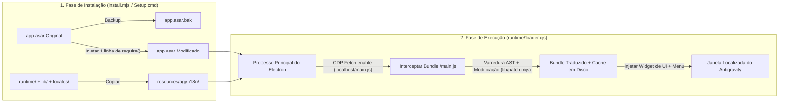

<div align="center">

# 🌐 Antigravity-i18n (`agy-i18n`)

**Localização Multilíngue de Interface e Seletor de Idioma em Tempo Real para o Cliente Desktop Google Antigravity**  
*Multilingual UI Localization & Live Language Switcher for the Google Antigravity Desktop Client*

[](https://github.com/Violiate/Antigravity-i18n/actions/workflows/ci-release.yml)
[](https://github.com/Violiate/Antigravity-i18n/releases)
[](#supported-languages)
[](#supported-languages)
[](#quick-start-tutorial)
[](../LICENSE)

<p align="center">
  <b>🌍 Leia esta documentação no seu idioma:</b><br>
  <a href="../README.md">English</a> ·
  <a href="./README.zh-CN.md">简体中文</a> ·
  <a href="./README.zh-TW.md">繁體中文</a> ·
  <a href="./README.ja.md">日本語</a> ·
  <a href="./README.ko.md">한국어</a> ·
  <a href="./README.es.md">Español</a> ·
  <a href="./README.fr.md">Français</a> ·
  <a href="./README.de.md">Deutsch</a> ·
  <strong>Português (Brasil)</strong> ·
  <a href="./README.ru.md">Русский</a>
</p>

</div>

---

## ✨ Visão Geral

**Antigravity-i18n** oferece localização multilíngue completa e alternância de idioma instantânea em tempo real para o **Cliente Desktop Google Antigravity**. Equipado com um mecanismo de varredura e modificação de strings baseado na Árvore de Sintaxe Abstrata (AST) do Acorn e um carregador de execução ultraleve para Electron, ele traduz **2.175 strings de interface** em **14 dos principais idiomas do mundo**, sem comprometer a sintaxe JavaScript nem alterar seus dados de usuário.

- 🌍 **14 Idiomas Principais**: Dicionários completos de 2.175 entradas para Chinês Simplificado (`zh-CN`), Chinês Tradicional (`zh-TW`), Japonês (`ja`), Coreano (`ko`), Espanhol (`es`), Francês (`fr`), Alemão (`de`), Português do Brasil (`pt-BR`), Russo (`ru`), Italiano (`it`), Vietnamita (`vi`), Turco (`tr`) e Árabe (`ar`), além de retorno direto sem alterações ao inglês original (`en`).
- ⚡ **Troca de Idioma em Tempo Real**: Alterne o idioma a qualquer momento a partir do **seletor flutuante no canto inferior direito**, da **barra de menu superior da janela (`Language / 语言`)** ou via **linha de comando (CLI)** — a interface é atualizada imediatamente sem necessidade de reinstalação.
- 🪄 **Instalador Gráfico para Windows Sem Dependências (`Setup.cmd`)**: O pacote ZIP autônomo para Windows inclui um ambiente oficial Node.js verificado por SHA-256 e todas as dependências necessárias. **Não requer Node.js, npm nem conexão à internet.**
- 🛡️ **Seguro e Reversível em 1 Clique**: Cria automaticamente um backup idêntico do seu `app.asar` original em `app.asar.bak` antes da instalação. Restaure o cliente original intocado a qualquer momento com apenas um clique.
- 🌐 **Configuração Segura de Proxy com Bypass de Localhost**: Configuração opcional de proxy HTTP/HTTPS que contorna automaticamente `localhost`, `127.0.0.1` e `[::1]`, garantindo comunicação direta e sem falhas com servidores locais de linguagem (Language Servers).

---

<a id="quick-start-tutorial"></a>

## 🚀 Tutorial de Início Rápido

### Opção A: Instalador Gráfico em 1 Clique para Windows (Recomendado — Sem necessidade de Node.js)

> **Visão Rápida**: Baixe `agy-i18n-1.1.0-windows-x64.zip` na página de Releases -> **Extraia completamente o arquivo ZIP** -> Feche completamente o Antigravity (inclusive na área de notificação da bandeja) -> Clique duas vezes em **`Setup.cmd`** -> Escolha seu idioma e clique em **"Instalar / Atualizar"**!

1. **Baixar o Pacote de Lançamento**  
   Acesse a página de [**Releases**](https://github.com/Violiate/Antigravity-i18n/releases) e baixe `agy-i18n-1.1.0-windows-x64.zip` (junto com o arquivo de verificação `.sha256` se desejar conferir a integridade).
2. **Extrair o Arquivo**  
   **Extraia toda a pasta ZIP** para qualquer diretório do seu computador. *(Não execute o `Setup.cmd` diretamente de dentro da janela de visualização do compactador ZIP.)*
3. **Fechar o Antigravity Completamente**  
   Salve seu trabalho e feche totalmente o cliente Antigravity (incluindo o ícone na área de notificação do sistema). O instalador verifica processos em execução e nunca encerrará sua sessão ativa à força.
4. **Executar o `Setup.cmd`**  
   Dê um duplo clique em **`Setup.cmd`** para abrir a interface gráfica do instalador:
   - **Diretório do Antigravity (`Antigravity 目录`)**: Detectado automaticamente. Se o seu cliente estiver em um local personalizado, clique em **浏览... (Procurar)** para selecionar a pasta do Antigravity ou sua subpasta `resources`.
   - **Idioma Inicial (`初始界面语言`)**: Selecione seu idioma de exibição preferido entre os 14 suportados.
   - **Proxy Opcional (`可选代理`)**: Deixe em branco se não for necessário, ou insira um endereço de proxy `http://` / `https://` (ex.: `http://127.0.0.1:7890`). Configurações de proxy existentes são preservadas automaticamente.
   - Clique em **安装 / 更新 (Instalar / Atualizar)**.
5. **Inicie e Aproveite!**  
   Abra o Antigravity normalmente a partir do seu atalho de costume.

---

### Opção B: Instalar a partir do Código-Fonte via CLI (Para Desenvolvedores)

#### 1. Pré-requisitos
- **Node.js**: `>= 22.12.0`
- **Cliente Desktop Google Antigravity** (validado no cliente Windows `2.29.0`)

#### 2. Clonar o Repositório e Instalar Dependências
```bash
git clone https://github.com/Violiate/Antigravity-i18n.git
cd Antigravity-i18n
npm install
```

#### 3. Aplicar o Patch de Localização
> [!IMPORTANT]
> Certifique-se de que o cliente de desktop Antigravity esteja **completamente fechado** antes de executar `install` ou `restore`.

```bash
# Instalação com o idioma padrão (zh-CN)
npm run setup
# Equivalente a: node install.mjs install

# Ou instalar especificando um idioma inicial (ex.: português do Brasil, japonês, espanhol)
node install.mjs install pt-BR
node install.mjs install ja
node install.mjs install es
```

Se o Antigravity estiver instalado em um diretório não padrão (por exemplo `D:\Program Files\Antigravity`), passe o argumento `--dir` ou defina a variável de ambiente `AGY_PATH`:

```bash
node install.mjs install --dir "D:\Program Files\Antigravity"
```

---

## 🔄 Alternando Idiomas em Tempo Real (3 Formas)

Após a instalação, você pode alterar o idioma da interface a qualquer momento sem precisar executar o instalador novamente:

1. **Seletor de Idioma Flutuante no Canto Inferior Direito**  
   Clique no botão arredondado de idioma no **canto inferior direito** da janela do Antigravity e escolha qualquer um dos 14 idiomas.
2. **Barra de Menus Superior da Janela**  
   Clique em **`Language / 语言`** no menu superior do aplicativo e selecione o idioma desejado.
3. **Linha de Comando (`language.mjs`)**  
   ```bash
   # Listar todos os códigos de idiomas suportados
   node language.mjs list

   # Alternar para qualquer código de idioma suportado
   node language.mjs pt-BR
   node language.mjs en
   node language.mjs zh-CN
   node language.mjs zh-TW
   node language.mjs ja
   node language.mjs ko
   node language.mjs es
   node language.mjs fr
   node language.mjs de
   node language.mjs ru
   node language.mjs it
   node language.mjs vi
   node language.mjs tr
   node language.mjs ar
   ```

> [!NOTE]
> A troca de idioma aciona o recarregamento da janela de renderização (`reloadIgnoringCache`) para que o novo pacote traduzido entre em vigor imediatamente. Salve ou envie qualquer conteúdo em digitação antes de alternar.

---

<a id="supported-languages"></a>

## 🌍 Idiomas Suportados

Todos os 13 dicionários de tradução estão localizados em [`locales/`](../locales) e são validados com o analisador de AST Acorn no CI:

| Código (`locale`) | Nome Nativo | Nome em Inglês | Chaves Traduzidas | Modo de Operação |
| :--- | :--- | :--- | :--- | :--- |
| `en` | English | English (Original) | Passagem direta | Interface original em inglês inalterada |
| `zh-CN` | 简体中文 | Simplified Chinese | 2.175 | Modificação dinâmica via AST |
| `zh-TW` | 繁體中文 | Traditional Chinese | 2.175 | Modificação dinâmica via AST |
| `ja` | 日本語 | Japanese | 2.175 | Modificação dinâmica via AST |
| `ko` | 한국어 | Korean | 2.175 | Modificação dinâmica via AST |
| `es` | Español | Spanish | 2.175 | Modificação dinâmica via AST |
| `fr` | Français | French | 2.175 | Modificação dinâmica via AST |
| `de` | Deutsch | German | 2.175 | Modificação dinâmica via AST |
| `pt-BR` | Português (Brasil) | Brazilian Portuguese | 2.175 | Modificação dinâmica via AST |
| `ru` | Русский | Russian | 2.175 | Modificação dinâmica via AST |
| `it` | Italiano | Italian | 2.175 | Modificação dinâmica via AST |
| `vi` | Tiếng Việt | Vietnamese | 2.175 | Modificação dinâmica via AST |
| `tr` | Türkçe | Turkish | 2.175 | Modificação dinâmica via AST |
| `ar` | العربية | Arabic | 2.175 | Modificação dinâmica via AST *(layout LTR)* |

---

## 🧠 Como Funciona



1. **Gancho Mínimo de Entrada no ASAR**: Durante a instalação, `install.mjs` cria uma cópia exata byte a byte (`app.asar.bak`), descompacta o arquivo `app.asar`, adiciona uma única linha `require('../agy-i18n/runtime/loader.cjs')` no início de `dist/main.js` e remonta o arquivo `app.asar`.
2. **Interceptação CDP Fetch**: Em tempo de execução, o `runtime/loader.cjs` conecta-se ao `webContents.debugger` de cada janela através do Chrome DevTools Protocol (`Fetch.enable`) e intercepta exclusivamente o script de renderização local (`http://localhost:*/main.js`).
3. **Substituição Segura de Strings via AST e Armazenamento em Cache**: `lib/scan.mjs` e `lib/patch.mjs` analisam o código JavaScript com `acorn`, identificam os literais visíveis na interface (ignorando identificadores de código e tokens internos), substituem as strings correspondentes com base em `locales/<locale>.json`, conferem se a AST resultante é válida e gravam o bundle corrigido em cache no disco identificado por `(sha256, locale)`.

---

## ⚙️ Status, Restauração e Configuração Avançada

### Verificar Status ou Restaurar o Cliente Original
- **Pela Interface Gráfica do Windows (`Setup.cmd`)**: Abra o `Setup.cmd` e clique em **检查状态 (Verificar Status)** ou **还原原版 (Restaurar Original)**.
- **Pela Linha de Comando (CLI)**:
  ```bash
  # Verificar status de instalação, caminho detectado e idioma ativo
  npm run status

  # Restaurar o arquivo original intacto app.asar (feche o Antigravity antes)
  npm run restore
  ```

### Arquivo de Configuração (`config.json`)
Após a instalação, as configurações são salvas em `<Antigravity>/resources/agy-i18n/config.json`:

```json
{
  "locale": "pt-BR",
  "proxy": "http://127.0.0.1:7890"
}
```

- `locale`: Código do idioma ativo da interface (`en`, `zh-CN`, `zh-TW`, `ja`, `ko`, `es`, `fr`, `de`, `pt-BR`, `ru`, `it`, `vi`, `tr`, `ar`).
- `proxy` *(opcional)*: Aceita URLs de proxy `http://` ou `https://`. Configura automaticamente o proxy de sessão/global do Electron com regras de bypass para `<local>;localhost;127.0.0.1;[::1]`.

---

## 📌 Escopo, Limitações e Perguntas Frequentes (FAQ)

- **O que acontece se o Antigravity for atualizado e a tradução sumir?**  
  Atualizações do cliente sobrescrevem o arquivo `app.asar`. Basta fechar o Antigravity, abrir o `Setup.cmd` (ou executar `npm run setup`) e clicar em **Instalar / Atualizar** novamente. Nenhum serviço em segundo plano permanece em execução quando o Antigravity é encerrado.
- **Por que algumas frases dinâmicas continuam em inglês?**  
  Apenas strings estáticas de interface presentes no arquivo local `/main.js` (2.175 chaves) são traduzidas. Respostas enviadas pelo servidor, modelos dinâmicos ou módulos carregados tardiamente fora de `/main.js` permanecem em inglês.
- **O idioma Árabe (`ar`) inclui inversão de layout RTL (direita para a esquerda)?**  
  O dicionário árabe contém todas as 2.175 strings traduzidas, mas a inversão completa do layout CSS para a direção RTL ainda não foi aplicada.
- **O Windows SmartScreen exibe a mensagem "O Windows protegeu o seu computador / Fornecedor desconhecido"?**  
  O pacote offline autônomo não possui um certificado comercial de assinatura de código pago. Clique em **Mais informações** -> **Executar assim mesmo**.
- **macOS e Linux são suportados?**  
  O pacote gráfico autônomo offline (`Setup.cmd`) é projetado para **Windows x64**. O arquivo `lib/env.mjs` contém utilitários de detecção de caminhos para macOS e Linux para experimentação via CLI, mas somente o Windows x64 passou por validação completa de ponta a ponta. Consulte [TESTING.md](../TESTING.md) para detalhes.

---

## 🧪 Testes, Empacotamento e Pipeline de CI/CD

Este repositório inclui um fluxo de trabalho automatizado do GitHub Actions ([`.github/workflows/ci-release.yml`](../.github/workflows/ci-release.yml)) executado a cada push, pull request e tag de versão `v*`:

1. **Testes Unitários e Integridade de AST (`npm test`)**: Valida todos os 13 arquivos JSON de idiomas (2.175 chaves cada) e executa testes de verificação sintática de varredura e modificação de AST do Acorn em todos os idiomas.
2. **Empacotamento Offline Determinístico para Windows (`npm run build:windows`)**: Faz download da distribuição oficial do Node.js `v22.23.4` para Windows x64, verifica o hash fixo SHA-256 (`cbc74b5e...`), inclui estritamente os arquivos da lista de permissões, gera o `MANIFEST.json` e produz `dist/agy-i18n-<version>-windows-x64.zip` e `.sha256`.
3. **Teste de Fumaça do Pacote Offline e GUI (`npm run test:package`)**: Remove o Node/npm do ambiente do desenvolvedor da variável `PATH`, descompacta o ZIP em um caminho contendo espaços e caracteres Unicode, confere os hashes de cada arquivo em relação ao `MANIFEST.json`, executa o ciclo `discover -> install -> status -> repeat install -> restore` contra um `app.asar` de teste e roda `Setup.ps1 -SmokeTest`.
4. **Publicação Automática de Releases no GitHub**: Ao enviar uma tag que comece com `v*` (por exemplo: `git tag v1.1.0 && git push origin v1.1.0`), o pipeline publica automaticamente os arquivos `.zip` e `.sha256` verificados no GitHub Releases.

```bash
# Executar testes unitários e de sintaxe multilíngue de AST
npm test

# Pré-visualizar a modificação offline de AST no main.js capturado (se disponível)
npm run preview:all

# Construir localmente o pacote ZIP autônomo para Windows x64
npm run build:windows

# Executar a bateria completa de testes de regressão do pacote offline e da GUI
npm run test:package
```

---

## 🤝 Contribuindo com Traduções

1. Os dicionários de idiomas ficam armazenados em [`locales/`](../locales) como `{ "String Original em Inglês": "String Traduzida" }`.
2. Os metadados de cada idioma estão registrados em [`locales/languages.json`](../locales/languages.json).
3. Após editar ou incluir traduções, execute `npm test` para certificar a correta formatação JSON, ausência de valores vazios e integridade sintática da AST antes de enviar um Pull Request.

---

## 📄 Licença

Distribuído sob a licença [MIT License](../LICENSE).
