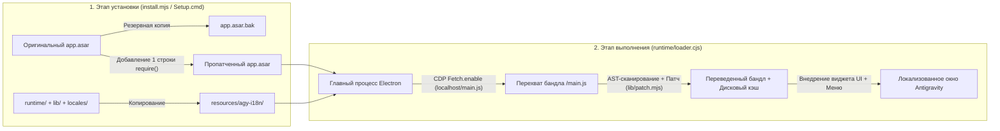

<div align="center">

# 🌐 Antigravity-i18n (`agy-i18n`)

**Многоязычная локализация интерфейса и переключатель языка в реальном времени для десктопного клиента Google Antigravity**  
*Multilingual UI Localization & Live Language Switcher for the Google Antigravity Desktop Client*

[](https://github.com/Violiate/Antigravity-i18n/actions/workflows/ci-release.yml)
[](https://github.com/Violiate/Antigravity-i18n/releases)
[](#supported-languages)
[](#supported-languages)
[](#quick-start-tutorial)
[](../LICENSE)

<p align="center">
  <b>🌍 Читать эту документацию на вашем языке:</b><br>
  <a href="../README.md">English</a> ·
  <a href="./README.zh-CN.md">简体中文</a> ·
  <a href="./README.zh-TW.md">繁體中文</a> ·
  <a href="./README.ja.md">日本語</a> ·
  <a href="./README.ko.md">한국어</a> ·
  <a href="./README.es.md">Español</a> ·
  <a href="./README.fr.md">Français</a> ·
  <a href="./README.de.md">Deutsch</a> ·
  <a href="./README.pt-BR.md">Português (Brasil)</a> ·
  <strong>Русский</strong>
</p>

</div>

---

## ✨ Обзор

**Antigravity-i18n** обеспечивает полноценную многоязычную локализацию и мгновенное переключение языка интерфейса на лету для десктопного клиента **Google Antigravity**. Инструмент основан на механизме синтаксического анализа и замены строк через AST (абстрактное синтаксическое дерево) библиотеки Acorn и легковесном загрузчике времени выполнения Electron. Он корректно переводит **2 175 строк интерфейса** на **14 основных языков мира**, не нарушая синтаксис JavaScript и не затрагивая данные пользователя.

- 🌍 **14 основных мировых языков**: Полные словари по 2 175 строк для упрощенного китайского (`zh-CN`), традиционного китайского (`zh-TW`), японского (`ja`), корейского (`ko`), испанского (`es`), французского (`fr`), немецкого (`de`), бразильского португальского (`pt-BR`), русского (`ru`), итальянского (`it`), вьетнамского (`vi`), турецкого (`tr`) и арабского (`ar`), а также моментальный возврат к нетронутому оригинальному английскому интерфейсу (`en`).
- ⚡ **Переключение языка на лету**: Сменяйте язык в любой момент через **плавающий переключатель в правом нижнем углу**, **верхнее меню окна (`Language / 语言`)** или через **командную строку (CLI)** — интерфейс обновляется мгновенно без повторной установки.
- 🪄 **Автономный графический установщик для Windows (`Setup.cmd`) без зависимостей**: Отдельный ZIP-архив релиза содержит официальную среду Node.js с фиксированной версией и проверкой SHA-256, а также все необходимые библиотеки. **Не требует установки Node.js, npm или подключения к интернету.**
- 🛡️ **Безопасность и откат в 1 клик**: Перед установкой автоматически создается точная побайтовая резервная копия оригинального файла `app.asar` с именем `app.asar.bak`. Вернуться к нетронутому оригиналу можно в любое время одним нажатием кнопки.
- 🌐 **Безопасная настройка прокси с исключением localhost**: Опциональная настройка HTTP/HTTPS-прокси, которая автоматически пускает в обход `localhost`, `127.0.0.1` и `[::1]`, сохраняя стабильное прямое подключение к локальным языковым серверам (Language Servers).

---

<a id="quick-start-tutorial"></a>

## 🚀 Краткое руководство

### Вариант A: Графический установщик в 1 клик для Windows (Рекомендуется — Node.js не требуется)

> **Краткая памятка**: Скачайте `agy-i18n-1.1.0-windows-x64.zip` со страницы Releases -> **Полностью распакуйте ZIP-архив в отдельную папку** -> Полностью закройте Antigravity (включая иконку в системном трее) -> Запустите двойным кликом **`Setup.cmd`** -> Выберите нужный язык и нажмите **«Установить / Обновить»**!

1. **Скачать пакет релиза**  
   Перейдите на страницу [**Releases**](https://github.com/Violiate/Antigravity-i18n/releases) и скачайте `agy-i18n-1.1.0-windows-x64.zip` (при необходимости можно также скачать контрольную сумму `.sha256` для проверки целостности).
2. **Распаковать архив**  
   **Извлеките всю папку из архива ZIP** в любое удобное место на диске. *(Не запускайте `Setup.cmd` прямо из окна предварительного просмотра архиватора без распаковки.)*
3. **Полностью закрыть Antigravity**  
   Сохраните текущую работу и полностью завершите работу клиента Antigravity (включая значок в области уведомлений/системном трее Windows). Программа установки проверяет запущенные процессы и никогда не завершит активную сессию принудительно.
4. **Запустить `Setup.cmd`**  
   Дважды щелкните по файлу **`Setup.cmd`**, чтобы открыть окно графического установщика:
   - **Каталог Antigravity (`Antigravity 目录`)**: Определяется автоматически. Если клиент установлен в нестандартном месте, нажмите **浏览... (Обзор)** и укажите папку Antigravity или ее подкаталог `resources`.
   - **Исходный язык интерфейса (`初始界面语言`)**: Выберите предпочитаемый язык из списка 14 поддерживаемых.
   - **Опциональный прокси (`可选代理`)**: Оставьте поле пустым, если прокси не требуется, либо укажите адрес в формате `http://` / `https://` (например: `http://127.0.0.1:7890`). Ранее настроенные параметры прокси сохраняются автоматически.
   - Нажмите **安装 / 更新 (Установить / Обновить)**.
5. **Запустите клиент и пользуйтесь!**  
   Запустите Antigravity привычным способом через ярлык на рабочем столе или в меню «Пуск».

---

### Вариант B: Установка из исходного кода через CLI (Для разработчиков)

#### 1. Системные требования
- **Node.js**: `>= 22.12.0`
- **Десктопный клиент Google Antigravity** (протестировано на версии Windows `2.29.0`)

#### 2. Клонирование репозитория и установка зависимостей
```bash
git clone https://github.com/Violiate/Antigravity-i18n.git
cd Antigravity-i18n
npm install
```

#### 3. Применение патча локализации
> [!IMPORTANT]
> Перед запуском команд `install` или `restore` убедитесь, что десктопный клиент Antigravity **полностью закрыт**.

```bash
# Установка с языком по умолчанию (zh-CN)
npm run setup
# Эквивалентно: node install.mjs install

# Либо установка с указанием конкретного начального языка (например: русский, японский, корейский)
node install.mjs install ru
node install.mjs install ja
node install.mjs install ko
```

Если Antigravity установлен в нестандартную директорию (например `D:\Program Files\Antigravity`), укажите параметр `--dir` или установите переменную окружения `AGY_PATH`:

```bash
node install.mjs install --dir "D:\Program Files\Antigravity"
```

---

## 🔄 Переключение языка на лету (3 способа)

После установки вы можете в любое время изменить язык интерфейса без повторного запуска программы установки:

1. **Плавающий переключатель в правом нижнем углу окна**  
   Нажмите на круглую кнопку выбора языка в **правом нижнем углу** окна Antigravity и выберите любой из 14 языков.
2. **Верхняя строка меню окна**  
   Нажмите **`Language / 语言`** в верхнем меню приложения и выберите желаемый язык.
3. **Командная строка (`language.mjs`)**  
   ```bash
   # Вывести список всех поддерживаемых кодов языков
   node language.mjs list

   # Переключить интерфейс на нужный язык
   node language.mjs ru
   node language.mjs en
   node language.mjs zh-CN
   node language.mjs zh-TW
   node language.mjs ja
   node language.mjs ko
   node language.mjs es
   node language.mjs fr
   node language.mjs de
   node language.mjs pt-BR
   node language.mjs it
   node language.mjs vi
   node language.mjs tr
   node language.mjs ar
   ```

> [!NOTE]
> Переключение языка вызывает перезагрузку процесса рендеринга (`reloadIgnoringCache`), благодаря чему переведенный бандл скрипта вступает в силу мгновенно. Пожалуйста, сохраните или отправьте введенный в текстовые поля текст перед переключением.

---

<a id="supported-languages"></a>

## 🌍 Поддерживаемые языки

Все 13 словарей локализации расположены в каталоге [`locales/`](../locales) и проходят регулярную валидацию с помощью AST-патчера Acorn в CI:

| Код (`locale`) | Родное название | Английское название | Переведенных строк | Режим работы |
| :--- | :--- | :--- | :--- | :--- |
| `en` | English | English (Original) | Прямой проброс | Неизмененный оригинальный интерфейс |
| `zh-CN` | 简体中文 | Simplified Chinese | 2 175 | Динамический AST-патч |
| `zh-TW` | 繁體中文 | Traditional Chinese | 2 175 | Динамический AST-патч |
| `ja` | 日本語 | Japanese | 2 175 | Динамический AST-патч |
| `ko` | 한국어 | Korean | 2 175 | Динамический AST-патч |
| `es` | Español | Spanish | 2 175 | Динамический AST-патч |
| `fr` | Français | French | 2 175 | Динамический AST-патч |
| `de` | Deutsch | German | 2 175 | Динамический AST-патч |
| `pt-BR` | Português (Brasil) | Brazilian Portuguese | 2 175 | Динамический AST-патч |
| `ru` | Русский | Russian | 2 175 | Динамический AST-патч |
| `it` | Italiano | Italian | 2 175 | Динамический AST-патч |
| `vi` | Tiếng Việt | Vietnamese | 2 175 | Динамический AST-патч |
| `tr` | Türkçe | Turkish | 2 175 | Динамический AST-патч |
| `ar` | العربية | Arabic | 2 175 | Динамический AST-патч *(макет LTR)* |

---

## 🧠 Принцип работы



1. **Минимальный хук на входе в ASAR**: При установке `install.mjs` создает побайтовую резервную копию (`app.asar.bak`), распаковывает `app.asar`, добавляет единственную строчку `require('../agy-i18n/runtime/loader.cjs')` в начало `dist/main.js` и повторно упаковывает `app.asar`.
2. **Перехват через CDP Fetch**: Во время работы `runtime/loader.cjs` подключается к `webContents.debugger` каждого открытого окна по протоколу Chrome DevTools Protocol (`Fetch.enable`) и перехватывает исключительно локальный скрипт рендерера (`http://localhost:*/main.js`).
3. **Безопасная замена строк через AST и кэширование**: `lib/scan.mjs` и `lib/patch.mjs` парсят JavaScript-код с помощью `acorn`, находят строковые литералы отображения UI (пропуская программные идентификаторы и внутренние токены), сопоставляют и подменяют строки из `locales/<locale>.json`, проверяют синтаксическую корректность полученного AST и кэшируют готовый пропатченный бандл на диске по ключу `(sha256, locale)`.

---

## ⚙️ Состояние, восстановление и расширенная конфигурация

### Проверка состояния или восстановление оригинального клиента
- **Через графический интерфейс Windows (`Setup.cmd`)**: Откройте `Setup.cmd` и нажмите **检查状态 (Проверить состояние)** или **还原原版 (Восстановить оригинал)**.
- **Через командную строку (CLI)**:
  ```bash
  # Проверить статус установки, найденный путь и активный язык
  npm run status

  # Восстановить исходный нетронутый файл app.asar (предварительно закройте Antigravity)
  npm run restore
  ```

### Файл конфигурации времени выполнения (`config.json`)
После установки настройки сохраняются в файле `<Каталог Antigravity>/resources/agy-i18n/config.json`:

```json
{
  "locale": "ru",
  "proxy": "http://127.0.0.1:7890"
}
```

- `locale`: Код активного языка интерфейса (`en`, `zh-CN`, `zh-TW`, `ja`, `ko`, `es`, `fr`, `de`, `pt-BR`, `ru`, `it`, `vi`, `tr`, `ar`).
- `proxy` *(опционально)*: Поддерживает URL-адреса прокси с протоколами `http://` или `https://`. Автоматически настраивает сессионный/глобальный прокси Electron с сохранением правил прямого подключения `<local>;localhost;127.0.0.1;[::1]`.

---

## 📌 Область применения, ограничения и часто задаваемые вопросы (FAQ)

- **Что делать, если Antigravity обновился и перевод пропал?**  
  При обновлении клиента файл `app.asar` перезаписывается. Достаточно полностью закрыть Antigravity, запустить `Setup.cmd` (или команду `npm run setup`) и снова нажать **«Установить / Обновить»**. Когда Antigravity закрыт, никакие фоновые службы программы не работают.
- **Почему некоторые динамические предложения остаются на английском?**  
  Патч производит замену только статических строк интерфейса внутри локального бандла `/main.js` (2 175 строк). Динамические ответы с сервера, составные шаблоны или модули с отложенной загрузкой вне файла `/main.js` остаются на английском.
- **Включает ли арабский язык (`ar`) зеркальное отображение макета справа налево (RTL)?**  
  Арабский словарь содержит все 2 175 переведенных строк, однако полноценная адаптация CSS-стилей для отображения справа налево (RTL) на данный момент не применяется.
- **Windows SmartScreen показывает окно «Система Windows защитила ваш компьютер / Неизвестный издатель»?**  
  Автономный установочный пакет не имеет платного коммерческого сертификата цифровой подписи кода. Нажмите **Подробнее** -> **Выполнить в любом случае**.
- **Поддерживаются ли macOS и Linux?**  
  Готовый автономный пакет с графическим интерфейсом (`Setup.cmd`) предназначен для **Windows x64**. В файле `lib/env.mjs` предусмотрены функции поиска путей для macOS и Linux для экспериментов через CLI, однако сквозное тестирование проводилось только на платформе Windows x64. Подробности см. в файле [TESTING.md](../TESTING.md).

---

## 🧪 Тестирование, сборка пакетов и CI/CD-пайплайн

В данном репозитории настроен автоматический рабочий процесс GitHub Actions ([`.github/workflows/ci-release.yml`](../.github/workflows/ci-release.yml)), запускаемый при каждом push, pull request и теге версии `v*`:

1. **Модульные тесты и проверка целостности AST (`npm test`)**: Проверяет все 13 JSON-файлов локализаций (по 2 175 ключей в каждом) и выполняет проверку синтаксической валидности AST Acorn после подстановки строк для каждого языка.
2. **Детерминированная сборка автономного пакета для Windows (`npm run build:windows`)**: Загружает официальный архив Node.js `v22.23.4` для Windows x64, сверяет жестко зафиксированную контрольную сумму SHA-256 (`cbc74b5e...`), собирает файлы среды выполнения строго по списку разрешений, генерирует `MANIFEST.json` и формирует `dist/agy-i18n-<версия>-windows-x64.zip` вместе с файлом `.sha256`.
3. **Дымовое тестирование автономного пакета и GUI (`npm run test:package`)**: Удаляет пути к Node/npm разработчика из переменной окружения `PATH`, распаковывает собранный ZIP по пути с пробелами и символами Unicode, проверяет хэш каждого файла по `MANIFEST.json`, выполняет полный цикл `discover -> install -> status -> repeat install -> restore` на тестовом `app.asar` и запускает скрипт самопроверки GUI `Setup.ps1 -SmokeTest`.
4. **Автоматическая публикация релизов на GitHub**: При пуше тега с маской `v*` (например: `git tag v1.1.0 && git push origin v1.1.0`) пайплайн автоматически публикует проверенные файлы `.zip` и `.sha256` в раздел GitHub Releases.

```bash
# Запустить модульные тесты и валидацию многоязычного AST
npm test

# Предварительный просмотр офлайн-патча AST на перехваченном main.js (при наличии)
npm run preview:all

# Собрать автономный ZIP-пакет для Windows x64 локально
npm run build:windows

# Запустить полный набор регрессионных тестов пакета и графического интерфейса
npm run test:package
```

---

## 🤝 Участие в переводе

1. Словари локализаций хранятся в папке [`locales/`](../locales) в формате `{ "Original English String": "Переведенная строка" }`.
2. Метаданные языков регистрируются в файле [`locales/languages.json`](../locales/languages.json).
3. После внесения изменений или добавления новых переводов выполните команду `npm test`, чтобы убедиться в корректности JSON, отсутствии пустых значений и синтаксической валидности AST перед созданием Pull Request.

---

## 📄 Лицензия

Проект распространяется под лицензией [MIT License](../LICENSE).
