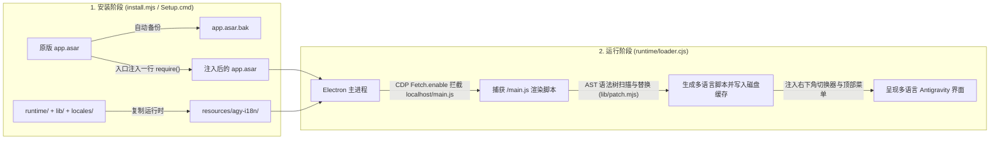

<div align="center">

# 🌐 Antigravity-i18n (`agy-i18n`)

**Google Antigravity 桌面客户端多语言本地化补丁与实时语言切换工具**  
*Multilingual UI Localization & Live Language Switcher for the Google Antigravity Desktop Client*

[](https://github.com/Violiate/Antigravity-i18n/actions/workflows/ci-release.yml)
[](https://github.com/Violiate/Antigravity-i18n/releases)
[](#supported-languages)
[](#supported-languages)
[](#quick-start-tutorial)
[](../LICENSE)

<p align="center">
  <b>🌍 选择文档语言 / Read in your language:</b><br>
  <a href="../README.md">English</a> ·
  <strong>简体中文</strong> ·
  <a href="./README.zh-TW.md">繁體中文</a> ·
  <a href="./README.ja.md">日本語</a> ·
  <a href="./README.ko.md">한국어</a> ·
  <a href="./README.es.md">Español</a> ·
  <a href="./README.fr.md">Français</a> ·
  <a href="./README.de.md">Deutsch</a> ·
  <a href="./README.pt-BR.md">Português (Brasil)</a> ·
  <a href="./README.ru.md">Русский</a>
</p>

</div>

---

## ✨ 项目简介

**Antigravity-i18n** 是专为 **Google Antigravity 桌面客户端** 打造的多语言本地化与实时语言切换工具。基于 Acorn AST 抽象语法树扫描与补丁引擎，以及轻量级 Electron 运行时加载器，它能够安全替换客户端内 **2,175 条界面短语**，支持 **14 种世界主流语言**，且无需修改或污染用户配置数据。

- 🌍 **支持 14 种主流语言**：内置简体中文（`zh-CN`）、繁体中文（`zh-TW`）、日语（`ja`）、韩语（`ko`）、西班牙语（`es`）、法语（`fr`）、德语（`de`）、巴西葡萄牙语（`pt-BR`）、俄语（`ru`）、意大利语（`it`）、越南语（`vi`）、土耳其语（`tr`）、阿拉伯语（`ar`）共 13 套完整词库（每语种 2,175 条），并支持随时切回原生英文（`en`）。
- ⚡ **应用内实时切换语言**：通过窗口**右下角悬浮语言选择器**、**顶部菜单栏 (`Language / 语言`)** 或**命令行**即可随时切换语言，界面自动刷新生效，无需重新安装或重启整个客户端。
- 🪄 **Windows 零依赖一键图形安装 (`Setup.cmd`)**：Release 离线包已内置固定版本并通过 SHA-256 校验的官方 Node.js 运行时与全部依赖，**普通用户无需安装 Node.js / npm，安装全程无需联网**。
- 🛡️ **AST 语法级安全替换与一键还原**：安装时自动备份原始 `app.asar` 为 `app.asar.bak`；随时可一键丝滑还原至字节级一致的原版客户端。
- 🌐 **安全的本地服务代理绕行**：支持可选的 HTTP/HTTPS 代理配置，自动为 `localhost`、`127.0.0.1`、`[::1]` 配置直连绕行，确保本地语言服务器（Language Server）正常通信。

---

<a id="quick-start-tutorial"></a>

## 🚀 保姆级安装教程

### 方式一：Windows 新手一键图形化安装（推荐，无需安装 Node.js）

1. **下载离线安装包**  
   前往 GitHub [**Releases 页面**](https://github.com/Violiate/Antigravity-i18n/releases)，下载最新的 `agy-i18n-1.1.0-windows-x64.zip`。
2. **完整解压压缩包**  
   将整个 ZIP 压缩包**完整解压到任意文件夹**中（请勿直接在压缩软件预览窗口内双击运行）。
3. **完全退出 Antigravity 客户端**  
   保存你正在编辑的工作，**完全退出 Antigravity**（包括系统托盘图标）。安装器会主动检查运行中的进程，绝不会强行杀死你的活动会话。
4. **双击运行 `Setup.cmd`**  
   双击解压目录下的 **`Setup.cmd`** 打开图形化安装界面：
   - **Antigravity 目录**：程序会自动探测默认安装路径；若你安装在其他盘符，点击 **“浏览...”** 选择 Antigravity 安装目录或其 `resources` 子目录即可。
   - **初始界面语言**：在下拉框中选择你偏好的语言（默认 `zh-CN` 简体中文）。
   - **可选代理**：不需要可留空；如需代理可填写 `http://127.0.0.1:7890` 等地址（已安装过的代理设置会自动读入保留）。
   - 点击 **“安装 / 更新”** 按钮。
5. **启动客户端**  
   按平时习惯从桌面或开始菜单启动 Antigravity 即可享受多语言界面！

---

### 方式二：开发者源码 / 命令行安装（CLI）

#### 1. 环境要求
- **Node.js**: `>= 22.12.0`
- **Google Antigravity 桌面客户端**（已在 Windows 客户端 `2.29.0` 验证）

#### 2. 克隆仓库并安装依赖
```bash
git clone https://github.com/Violiate/Antigravity-i18n.git
cd Antigravity-i18n
npm install
```

#### 3. 安装多语言补丁
> [!IMPORTANT]
> 首次安装、更新或还原 `app.asar` 前，请先**完全退出 Antigravity 客户端**。

```bash
# 默认安装（初始语言设为简体中文 zh-CN）
npm run setup
# 或：node install.mjs install

# 安装并直接指定初始语言（例如繁体中文 zh-TW、日语 ja、韩语 ko）
node install.mjs install zh-TW
node install.mjs install ja
node install.mjs install ko
```

如果你的 Antigravity 安装在非默认位置（例如 `D:\Program Files\Antigravity`），可通过 `--dir` 参数或 `AGY_PATH` 环境变量指定：

```bash
node install.mjs install --dir "D:\Program Files\Antigravity"
```

---

## 🔄 实时切换显示语言（3 种方式）

安装完成后，你可以通过以下任意方式实时切换界面语言，无需重新打包或重装：

1. **界面右下角语言选择器**：点击 Antigravity 窗口**右下角的悬浮语言胶囊按钮**，在下拉菜单中直接选择目标语言。
2. **顶部窗口菜单栏**：点击窗口顶部菜单栏的 **`Language / 语言`**，选择需要切换的语言。
3. **命令行工具 (`language.mjs`)**：
   ```bash
   # 查看所有可用语言代码
   node language.mjs list

   # 切换为任意目标语言
   node language.mjs zh-CN
   node language.mjs zh-TW
   node language.mjs ja
   node language.mjs ko
   node language.mjs es
   node language.mjs fr
   node language.mjs de
   node language.mjs pt-BR
   node language.mjs ru
   node language.mjs en
   ```

> [!NOTE]
> 切换语言会自动刷新渲染层视图（`reloadIgnoringCache`）以加载新语种脚本，切换前请先保存或提交输入框中未发送的内容。

---

<a id="supported-languages"></a>

## 🌍 支持的语言列表

所有语言词库均位于 [`locales/`](../locales) 目录下，并在 CI 中通过完整的 AST 解析校验：

| 语言代码 (`locale`) | 语言名称 (Native) | 英文名称 (English) | 翻译词条数 | 运行模式 |
| :--- | :--- | :--- | :--- | :--- |
| `en` | English | English (Original) | 原生直通 | 原版英文界面 |
| `zh-CN` | 简体中文 | Simplified Chinese | 2,175 | AST 动态替换 |
| `zh-TW` | 繁體中文 | Traditional Chinese | 2,175 | AST 动态替换 |
| `ja` | 日本語 | Japanese | 2,175 | AST 动态替换 |
| `ko` | 한국어 | Korean | 2,175 | AST 动态替换 |
| `es` | Español | Spanish | 2,175 | AST 动态替换 |
| `fr` | Français | French | 2,175 | AST 动态替换 |
| `de` | Deutsch | German | 2,175 | AST 动态替换 |
| `pt-BR` | Português (Brasil) | Brazilian Portuguese | 2,175 | AST 动态替换 |
| `ru` | Русский | Russian | 2,175 | AST 动态替换 |
| `it` | Italiano | Italian | 2,175 | AST 动态替换 |
| `vi` | Tiếng Việt | Vietnamese | 2,175 | AST 动态替换 |
| `tr` | Türkçe | Turkish | 2,175 | AST 动态替换 |
| `ar` | العربية | Arabic | 2,175 | AST 动态替换 *(未含 RTL 镜像布局)* |

---

## 🧠 工作原理



---

## ⚙️ 状态检查、一键还原与高级配置

### 检查状态或还原原版
- **通过 Windows 图形界面 (`Setup.cmd`)**：打开 `Setup.cmd`，点击 **“检查状态”** 或 **“还原原版”**。
- **通过命令行 (CLI)**：
  ```bash
  # 查看当前安装状态、安装路径与当前激活语言
  npm run status

  # 完全退出 Antigravity 后，一键恢复原始未修改的 app.asar
  npm run restore
  ```

### 运行时配置文件 (`config.json`)
安装后，配置文件保存在 `<Antigravity安装目录>/resources/agy-i18n/config.json`：

```json
{
  "locale": "zh-CN",
  "proxy": "http://127.0.0.1:7890"
}
```

- `locale`：当前界面语言代码。
- `proxy`（可选）：仅支持 `http://` 或 `https://` 代理地址。配置后会自动为客户端设置网络代理，同时确保 `localhost` / `127.0.0.1` / `[::1]` 本地通信直连不走代理。

---

## 📌 常见问题与已知限制 (FAQ)

- **客户端自动更新后翻译失效怎么办？**  
  客户端升级会覆盖 `app.asar`。只需完全退出 Antigravity，重新打开 `Setup.cmd`（或执行 `npm run setup`）并点击 **“安装 / 更新”** 即可。本工具无常驻后台守护进程。
- **为什么少量句子仍显示为英文？**  
  补丁仅安全替换本地 `/main.js` 中的静态 UI 字符串（共 2,175 条）。服务端返回的动态文本、动态拼接模板或懒加载模块不在静态替换范围内。
- **Windows 弹出“Windows 已保护你的电脑 / 未知发布者”提示？**  
  离线安装包未购买商业代码签名证书，点击 **“更多信息” -> “仍要运行”** 即可。默认用户目录安装无需管理员权限；若客户端安装在受保护的系统目录，可能需要相应写入权限。

---

## 🧪 自动化测试与 GitHub Actions CI 构建流水线

本仓库配置了完整的 GitHub Actions CI/CD 流水线（[`.github/workflows/ci-release.yml`](../.github/workflows/ci-release.yml)）：

1. **全语种词库与 AST 语法测试 (`npm test`)**：自动校验全部 13 个语言包（各 2,175 词条）及 AST 补丁后的 JS 语法合法性。
2. **构建 Windows 独立离线包 (`npm run build:windows`)**：拉取固定版本官方 Node.js `v22.23.4` 并校验 SHA-256，按白名单打包运行时、词库与依赖，生成 `dist/agy-i18n-<version>-windows-x64.zip`、`.sha256` 及包内逐文件哈希清单 `MANIFEST.json`。
3. **离线包端到端与 GUI 冒烟回归 (`npm run test:package`)**：在移除开发者 Node 环境变量的纯净条件下解压离线包，校验所有文件哈希，针对模拟 `app.asar` 完整执行 `discover -> install -> status -> 重复 install -> restore` 字节级还原验证，并运行 `Setup.ps1 -SmokeTest` 图形界面自检。
4. **Tag 自动发布 Release**：当推送 `v*` 标签（如 `v1.1.0`）时，流水线会自动将构建并验证通过的 `.zip` 与 `.sha256` 发布至 GitHub Releases。

---

## 📄 开源协议

本项目基于 [MIT License](../LICENSE) 开源。
