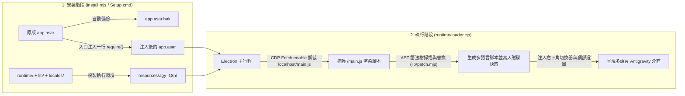

<div align="center">

# 🌐 Antigravity-i18n (`agy-i18n`)

**Google Antigravity 桌面客戶端多語言本地化補丁與即時語言切換工具**  
*Multilingual UI Localization & Live Language Switcher for the Google Antigravity Desktop Client*

[](https://github.com/Violiate/Antigravity-i18n/actions/workflows/ci-release.yml)
[](https://github.com/Violiate/Antigravity-i18n/releases)
[](#supported-languages)
[](#supported-languages)
[](#quick-start-tutorial)
[](../LICENSE)

<p align="center">
  <b>🌍 選擇文檔語言 / Read in your language:</b><br>
  <a href="../README.md">English</a> ·
  <a href="./README.zh-CN.md">简体中文</a> ·
  <strong>繁體中文</strong> ·
  <a href="./README.ja.md">日本語</a> ·
  <a href="./README.ko.md">한국어</a> ·
  <a href="./README.es.md">Español</a> ·
  <a href="./README.fr.md">Français</a> ·
  <a href="./README.de.md">Deutsch</a> ·
  <a href="./README.pt-BR.md">Português (Brasil)</a> ·
  <a href="./README.ru.md">Русский</a>
</p>

</div>

---

## ✨ 專案簡介

**Antigravity-i18n** 是專為 **Google Antigravity 桌面客戶端** 打造的多語言本地化與即時語言切換工具。基於 Acorn AST 抽象語法樹掃描與補丁引擎，以及輕量級 Electron 執行階段載入器，它能夠安全替換客戶端內 **2,175 條介面短語**，支援 **14 種世界主流語言**，完全不會破壞 JavaScript 語法結構，亦不會修改或污染使用者個人資料。

- 🌍 **支援 14 種主流語言**：內建繁體中文（`zh-TW`）、簡體中文（`zh-CN`）、日語（`ja`）、韓語（`ko`）、西班牙語（`es`）、法語（`fr`）、德語（`de`）、巴西葡萄牙語（`pt-BR`）、俄語（`ru`）、義大利語（`it`）、越南語（`vi`）、土耳其語（`tr`）、阿拉伯語（`ar`）共 13 套完整字典（每語種 2,175 條），並支援隨時切回原生英文（`en`）。
- ⚡ **應用程式內即時切換語言**：透過視窗**右下角懸浮語言選擇器**、**頂部選單列 (`Language / 語言`)** 或**命令列**即可隨時切換語言，介面即時重新載入生效，無需重新安裝或重啟整個客戶端。
- 🪄 **Windows 零依賴一鍵圖形安裝 (`Setup.cmd`)**：Release 離線包內建固定版本且經 SHA-256 校驗的官方 Node.js 執行階段與全部依賴，**一般使用者無需安裝 Node.js / npm，安裝全程無需聯網**。
- 🛡️ **AST 語法級安全替換與一鍵還原**：安裝時自動將原始 `app.asar` 備份為 `app.asar.bak`；隨時可一鍵平滑還原至位元組級一致的原版客戶端。
- 🌐 **安全的本地伺服器代理繞道**：支援可選的 HTTP/HTTPS 代理設定，自動為 `localhost`、`127.0.0.1`、`[::1]` 設定直連繞道，確保本機語言伺服器（Language Server）正常通訊。

---

<a id="quick-start-tutorial"></a>

## 🚀 快速上手教學

### 方式一：Windows 新手一鍵圖形化安裝（推薦，無需安裝 Node.js）

> **快速預覽**：下載 Release 中的 `agy-i18n-1.1.0-windows-x64.zip` -> **完整解壓縮整個資料夾** -> 完全關閉 Antigravity（包含系統匣圖示） -> 按兩下 **`Setup.cmd`** -> 選擇語言並點擊 **「安裝 / 更新」** 即可！

1. **下載離線安裝包**  
   前往 GitHub [**Releases 頁面**](https://github.com/Violiate/Antigravity-i18n/releases)，下載最新的 `agy-i18n-1.1.0-windows-x64.zip`（如需驗證完整性可同時下載對應的 `.sha256` 檔案）。
2. **完整解壓縮壓縮檔**  
   將整個 ZIP 壓縮包**完整解壓縮到任意資料夾**中（請勿直接在解壓縮軟體預覽視窗內按兩下執行）。
3. **完全關閉 Antigravity 客戶端**  
   儲存你正在編輯的工作，**完全退出 Antigravity**（包括系統匣工作列圖示）。安裝程式會主動檢查執行中的處理程序，絕不會強制終止使用中的工作階段。
4. **按兩下執行 `Setup.cmd`**  
   按兩下解壓縮目錄下的 **`Setup.cmd`** 開啟圖形化安裝介面：
   - **Antigravity 目錄 (`Antigravity 目录`)**：程式會自動偵測預設安裝路徑；若安裝在其他磁碟機，點擊 **「瀏覽... (Browse)」** 選擇 Antigravity 安裝目錄或其 `resources` 子目錄即可。
   - **初始介面語言 (`初始界面语言`)**：在下拉選單中選擇偏好的語言（預設 `zh-TW` 繁體中文或 `zh-CN` 簡體中文）。
   - **可選代理 (`可选代理`)**：不需要可留空；如需代理可填寫 `http://127.0.0.1:7890` 等地址（原有的代理設定會自動保留）。
   - 點擊 **「安裝 / 更新 (Install / Update)」** 按鈕。
5. **啟動客戶端**  
   依平時習慣從桌面或開始功能表啟動 Antigravity，即可體驗多語言介面！

---

### 方式二：開發者源碼 / 命令列安裝（CLI）

#### 1. 環境需求
- **Node.js**: `>= 22.12.0`
- **Google Antigravity 桌面客戶端**（已在 Windows 客戶端 `2.29.0` 驗證）

#### 2. 複製儲存庫並安裝依賴
```bash
git clone https://github.com/Violiate/Antigravity-i18n.git
cd Antigravity-i18n
npm install
```

#### 3. 套用多語言補丁
> [!IMPORTANT]
> 首次安裝、更新或還原 `app.asar` 前，請先**完全關閉 Antigravity 客戶端**。

```bash
# 預設安裝（初始語言設為簡體中文 zh-CN）
npm run setup
# 或：node install.mjs install

# 安裝並直接指定初始語言（例如繁體中文 zh-TW、日語 ja、韓語 ko）
node install.mjs install zh-TW
node install.mjs install ja
node install.mjs install ko
```

如果你的 Antigravity 安裝在非預設路徑（例如 `D:\Program Files\Antigravity`），可透過 `--dir` 參數或 `AGY_PATH` 環境變數指定：

```bash
node install.mjs install --dir "D:\Program Files\Antigravity"
```

---

## 🔄 即時切換顯示語言（3 種方式）

安裝完成後，你可以透過以下任意方式即時切換介面語言，無需重新安裝或重啟整個客戶端：

1. **介面右下角語言選擇器**：點擊 Antigravity 視窗**右下角的懸浮語言膠囊按鈕**，在下拉選單中直接選擇目標語言。
2. **頂部視窗功能表列**：點擊視窗頂部功能表列的 **`Language / 語言`**，選擇需要切換的語言。
3. **命令列工具 (`language.mjs`)**：
   ```bash
   # 查看所有可用語言代碼
   node language.mjs list

   # 切換為任意目標語言
   node language.mjs zh-TW
   node language.mjs zh-CN
   node language.mjs ja
   node language.mjs ko
   node language.mjs es
   node language.mjs fr
   node language.mjs de
   node language.mjs pt-BR
   node language.mjs ru
   node language.mjs it
   node language.mjs vi
   node language.mjs tr
   node language.mjs ar
   node language.mjs en
   ```

> [!NOTE]
> 切換語言會自動重新載入渲染視圖（`reloadIgnoringCache`）以載入新語言指令碼，切換前請先儲存或提交輸入框中未發送的內容。

---

<a id="supported-languages"></a>

## 🌍 支援的語言列表

所有語言字典檔均位於 [`locales/`](../locales) 目錄下，並在 CI 中通過完整的 AST 解析校驗：

| 語言代碼 (`locale`) | 本地名稱 (Native) | 英文名稱 (English) | 翻譯詞條數 | 運作模式 |
| :--- | :--- | :--- | :--- | :--- |
| `en` | English | English (Original) | 原生直通 | 原版英文介面 |
| `zh-TW` | 繁體中文 | Traditional Chinese | 2,175 | AST 動態替換 |
| `zh-CN` | 简体中文 | Simplified Chinese | 2,175 | AST 動態替換 |
| `ja` | 日本語 | Japanese | 2,175 | AST 動態替換 |
| `ko` | 한국어 | Korean | 2,175 | AST 動態替換 |
| `es` | Español | Spanish | 2,175 | AST 動態替換 |
| `fr` | Français | French | 2,175 | AST 動態替換 |
| `de` | Deutsch | German | 2,175 | AST 動態替換 |
| `pt-BR` | Português (Brasil) | Brazilian Portuguese | 2,175 | AST 動態替換 |
| `ru` | Русский | Russian | 2,175 | AST 動態替換 |
| `it` | Italiano | Italian | 2,175 | AST 動態替換 |
| `vi` | Tiếng Việt | Vietnamese | 2,175 | AST 動態替換 |
| `tr` | Türkçe | Turkish | 2,175 | AST 動態替換 |
| `ar` | العربية | Arabic | 2,175 | AST 動態替換 *(未含 RTL 鏡像佈局)* |

---

## 🧠 運作原理



1. **極簡 ASAR 入口掛鉤**：安裝時 `install.mjs` 自動備份原版為 `app.asar.bak`，解包 `app.asar` 並在 `dist/main.js` 最前方僅注入一行 `require('../agy-i18n/runtime/loader.cjs')`，再重新打包封裝。
2. **CDP Fetch 動態攔截**：執行階段 `runtime/loader.cjs` 透過 Chrome DevTools Protocol (`Fetch.enable`) 掛載至每個視窗的 `webContents.debugger`，僅精確攔截本機渲染指令碼（`http://localhost:*/main.js`）。
3. **AST 語法級替換與快取機制**：`lib/scan.mjs` 與 `lib/patch.mjs` 使用 `acorn` 解析 JS 語法樹，精準定位介面靜態字串，自動跳過程式碼標識符與系統內部識別碼，替換為 `locales/<locale>.json` 中的譯文，校驗 AST 語法無誤後將修補後的 Bundle 依 `(sha256, locale)` 快取至本機磁碟。

---

## ⚙️ 狀態檢查、一鍵還原與進階設定

### 檢查狀態或還原原版
- **透過 Windows 圖形介面 (`Setup.cmd`)**：開啟 `Setup.cmd`，點擊 **「檢查狀態」** 或 **「還原原版」**。
- **透過命令列 (CLI)**：
  ```bash
  # 檢視當前安裝狀態、安裝路徑與當前啟用語言
  npm run status

  # 完全關閉 Antigravity 後，一鍵還原原始未修改的 app.asar
  npm run restore
  ```

### 執行階段設定檔 (`config.json`)
安裝後，設定檔保存在 `<Antigravity安裝目錄>/resources/agy-i18n/config.json`：

```json
{
  "locale": "zh-TW",
  "proxy": "http://127.0.0.1:7890"
}
```

- `locale`：目前介面語言代碼（`en`, `zh-TW`, `zh-CN`, `ja`, `ko`, `es`, `fr`, `de`, `pt-BR`, `ru`, `it`, `vi`, `tr`, `ar`）。
- `proxy`（可選）：僅支援 `http://` 或 `https://` 代理網址。設定後會自動為客戶端套用網路代理，同時強制直連繞道 `<local>;localhost;127.0.0.1;[::1]`，確保本機語言伺服器不受干擾。

---

## 📌 常見問題與限制 (FAQ)

- **客戶端自動更新後翻譯失效怎麼辦？**  
  客戶端升級會覆蓋 `app.asar`。只需完全關閉 Antigravity，重新執行 `Setup.cmd`（或執行 `npm run setup`）並點擊 **「安裝 / 更新」** 即可。本工具無常駐背景精靈處理程序。
- **為什麼少數句子仍顯示為英文？**  
  補丁僅安全替換本機 `/main.js` 中的靜態 UI 字串（共 2,175 條）。伺服器端動態回傳內容、動態拼接範本或延遲載入模組不在此靜態替換範圍內。
- **阿拉伯語 (`ar`) 是否包含 RTL 鏡像佈局？**  
  阿拉伯語詞庫完整收錄全部 2,175 條翻譯，但目前尚未套用完整的從右到左 (RTL) CSS 佈局鏡像變換。
- **Windows 出現「Windows 已保護您的電腦 / 未知的發行者」提示？**  
  離線安裝包未購買昂貴的商業程式碼簽署憑證，點擊 **「其他資訊」 -> 「仍要執行」** 即可。預設使用者路徑安裝無需系統管理員權限；若安裝於受保護的系統目錄，可能需相應的寫入權限。
- **是否支援 macOS 或 Linux？**  
  預先建置的離線圖形安裝包 (`Setup.cmd`) 專為 **Windows x64** 設計。`lib/env.mjs` 包含適用於 macOS 與 Linux 的 CLI 路徑搜尋邏輯，但目前僅在 Windows x64 完成端對端驗證。詳見 [TESTING.md](../TESTING.md)。

---

## 🧪 自動化測試與 GitHub Actions CI/CD 流水線

本儲存庫配置了完整的 GitHub Actions 自動化工作流程（[`.github/workflows/ci-release.yml`](../.github/workflows/ci-release.yml)），在每次推送、拉取請求與 `v*` 版本標籤觸發：

1. **單元測試與全語系 AST 語法校驗 (`npm test`)**：自動驗證全部 13 個語言字典檔（各 2,175 條詞目）及 Acorn AST 補丁後的 JS 語法正確性。
2. **Windows 獨立離線安裝包建置 (`npm run build:windows`)**：自動下載官方 Node.js `v22.23.4` 並校驗固定 SHA-256，按嚴格白名單封裝執行階段、語言庫與相依套件，產生 `dist/agy-i18n-<version>-windows-x64.zip`、`.sha256` 以及逐檔案雜湊清單 `MANIFEST.json`。
3. **離線包端到端與 GUI 冒煙迴歸測試 (`npm run test:package`)**：在移除開發者 Node 系統路徑的純淨環境中解壓縮離線包，校驗所有檔案雜湊，針對模擬 `app.asar` 執行 `discover -> install -> status -> 重複 install -> restore` 位元組級還原驗證，並執行 `Setup.ps1 -SmokeTest` 圖形介面自我檢測。
4. **自動化 GitHub Releases 發布**：推送符合 `v*` 的標籤（如 `git tag v1.1.0 && git push origin v1.1.0`）時，流水線將自動把建置並通過測試的 `.zip` 與 `.sha256` 發布至 GitHub Releases。

```bash
# 執行單元測試與多語言 AST 校驗
npm test

# 預覽捕捉到的 main.js 離線補丁效果（若存在）
npm run preview:all

# 本地建置獨立 Windows x64 離線壓縮包
npm run build:windows

# 執行完整的離線安裝包與 GUI 冒煙迴歸測試
npm run test:package
```

---

## 🤝 貢獻翻譯

1. 各語言字典檔保存在 [`locales/`](../locales) 目錄中，格式為 `{ "英文原文": "翻譯文字" }`。
2. 語言元數據註冊在 [`locales/languages.json`](../locales/languages.json) 中。
3. 修改或新增翻譯後，請執行 `npm test` 確認 JSON 格式無誤、無空值且通過 AST 語法校驗，然後發起 Pull Request。

---

## 📄 開源協議

本專案基於 [MIT License](../LICENSE) 開源授權。
